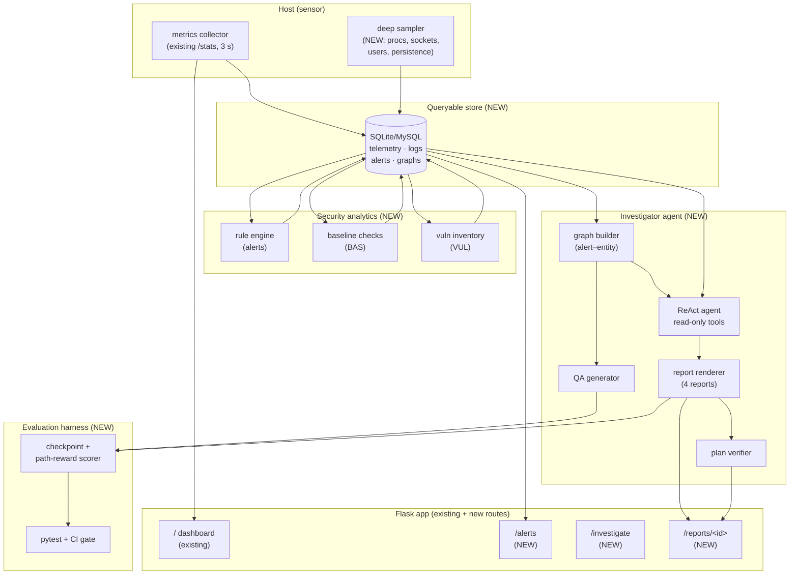
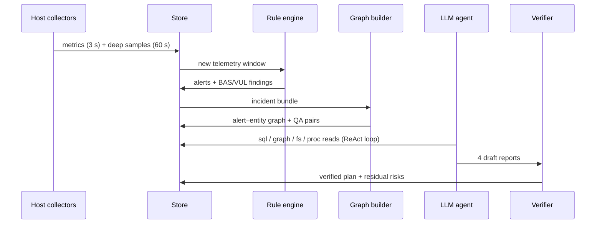

# AI-Agent Assisted System Monitoring and Post-Compromise Incident Response

## Project Report — Proposed Methodology

| Item | Details |
|---|---|
| **Project** | System Monitor — extended with AI-agent assisted threat investigation and incident response |
| **Base Paper 1** | Wang et al., *SecRespond: Benchmarking AI Agents for Real-World Post-Compromise Incident Response*, arXiv:2607.26791v1, 30 July 2026 (Tongyi Lab / Alibaba Cloud / HKUST) |
| **Base Paper 2** | Wu et al., *ExCyTIn-Bench: Evaluating LLM agents on Cyber Threat Investigation*, Proc. 43rd ICML, PMLR 306, 2026 (Penn State / Microsoft Security AI Research / Tsinghua / AG2AI) |
| **Repository** | `Sothiraj/system-monitor` (Flask + psutil + Bootstrap 5 + Chart.js) |
| **Date** | November 2026 |

---

## Table of Contents

1. [Abstract](#1-abstract)
2. [Introduction](#2-introduction)
3. [Base Paper Study](#3-base-paper-study)
4. [Literature Survey and Related Work](#4-literature-survey-and-related-work)
5. [Existing System and Its Limitations](#5-existing-system-and-its-limitations)
6. [Problem Statement and Objectives](#6-problem-statement-and-objectives)
7. [Proposed System Overview](#7-proposed-system-overview)
8. [Proposed Methodology](#8-proposed-methodology)
9. [System Architecture and Data Flow](#9-system-architecture-and-data-flow)
10. [Module Description](#10-module-description)
11. [Algorithms](#11-algorithms)
12. [Technology Stack](#12-technology-stack)
13. [Evaluation Plan](#13-evaluation-plan)
14. [Implementation Roadmap](#14-implementation-roadmap)
15. [Expected Outcomes](#15-expected-outcomes)
16. [Conclusion and Future Scope](#16-conclusion-and-future-scope)
17. [References](#17-references)

---

## 1. Abstract

Host security operations today face a scale problem: analysts must sift through
large volumes of heterogeneous telemetry and logs, correlate multi-hop chains of
evidence, and then write verified remediation plans — all under time pressure.
Two recent benchmarks define this challenge precisely. **SecRespond** (Wang et
al., 2026) shows that LLM agents placed in a *post-compromise* setting — a
forensic disk snapshot plus alerts, vulnerability scans and baseline checks —
can surface alert-exposed problems but fail to proactively hunt silent
intrusions or produce complete, verified remediation plans (no model completes
detection + remediation on any of its 10 cyber ranges). **ExCyTIn-Bench** (Wu
et al., ICML 2026) shows that even the best agents score only 0.606 reward when
investigating threats by querying 57 security log tables through automatically
generated investigation graphs.

This report proposes a methodology that turns our existing lightweight
**System Monitor** (a Flask/psutil dashboard streaming live CPU, RAM, disk and
network telemetry) into an **AI-agent assisted monitoring and incident-response
platform**. The methodology keeps the current collector as the *sensor layer*,
adds a *security analytics layer* (rule-based alerts, baseline checks,
vulnerability inventory), builds *investigation graphs* linking alerts to host
entities (processes, files, IPs, users), and drives an *LLM investigator agent*
(ReAct loop over read-only host/SQL/file tools) that produces SecRespond-style
forensic reports — intrusion analysis, baseline-risk assessment,
vulnerability-risk assessment — plus a verified remediation plan. Evaluation
adapts both base papers: hierarchical detection/planning checkpoints with a
five-dimension capability taxonomy (from SecRespond) and graph-anchored partial
rewards for investigation questions (from ExCyTIn-Bench).

**Keywords:** system monitoring, incident response, LLM agents, threat
investigation, post-compromise forensics, investigation graphs, psutil, Flask.

---

## 2. Introduction

### 2.1 Background

Security monitoring has traditionally been split into two worlds: **performance
monitoring** (CPU, memory, disk, network dashboards) and **security operations**
(SIEM alerts, forensics, incident response). The former is continuous and
lightweight but security-blind; the latter is security-aware but heavyweight,
manual, and reactive. Our repository implements the former: a small Flask
application (`app.py`) exposes `/` (dashboard), `/stats` (JSON telemetry) and
`/healthz`, while `utils/monitor.py` collects host metrics with `psutil` and
`templates/index.html` renders live Chart.js graphs polling every 3 seconds.

### 2.2 Motivation from the base papers

Recent research argues that LLM agents with tool access (CLIs, SQL, file reads)
are the natural bridge between these worlds — but only if they are rigorously
tested in realistic, *post-compromise* conditions rather than clean,
pre-compromise sandboxes:

- **SecRespond** constructs 10 cyber ranges from real compromised cloud hosts
  (4 entry-point types, 21 MITRE ATT&CK techniques, 5 operating systems) and
  requires agents to investigate a forensic disk snapshot and emit four
  reports. Its headline result — *detection consistently beats planning, and no
  model finishes any range* — proves that remediation planning, not alert
  triage, is the bottleneck.
- **ExCyTIn-Bench** builds a controlled Azure tenant ("Alpine Ski House") with
  57 Sentinel log tables and 7,542 investigation questions derived from
  bipartite alert–entity graphs. Agents act through SQL queries; partial credit
  is given for reaching intermediate graph nodes. Its headline result —
  *best reward 0.606* — proves that multi-hop log investigation remains hard
  even for frontier models.

### 2.3 What this report proposes

We propose a methodology to evolve the System Monitor, step by step, into a
platform where:

1. Every host continuously streams telemetry (already implemented).
2. A analytics layer converts telemetry + logs into **alerts, baselines and
   vulnerability findings** (new).
3. Alerts and entities are linked into an **investigation graph** (new,
   following ExCyTIn-Bench).
4. An **LLM investigator agent** explores the graph/host with read-only tools
   and writes **forensic reports + a remediation plan** (new, following
   SecRespond).
5. A built-in **evaluation harness** scores the agent with checkpoints and
   graph rewards, so every improvement is measurable (new, combining both
   papers).

---

## 3. Base Paper Study

### 3.1 Base Paper 1 — SecRespond (Wang et al., 2026)

| Aspect | Details |
|---|---|
| **Problem** | Existing benchmarks test agents *before* compromise in clean environments; the realistic post-compromise workflow is untested |
| **Task** | Given a forensic disk snapshot + host-security-product outputs (alerts, vuln scans, baseline checks), produce 1 progress file + 4 reports: intrusion analysis, baseline risks, vulnerability risks, remediation plan |
| **Testbed** | 10 cyber ranges from frozen snapshots of real compromised cloud hosts; 4 entry types; 21 ATT&CK techniques; 5 OSs; 12-stage construction pipeline with human audit |
| **Evaluation** | Hierarchical rubric: **280 checkpoints** mapped to **52 capability items** in a 5-dimension CAP taxonomy — Intrusion Entity (ENT), Persistence Mechanism (PER), Baseline Risk (BAS), Vulnerability Risk (VUL), Investigation & Response Quality (Q); each checkpoint scored on **Detection** and **Planning** axes via LLM-as-a-Judge (3 judges) |
| **Harness** | OpenCode agent harness; 23 frontier LLMs evaluated |
| **Key findings** | (1) Best model (Claude Opus 4.7) ≈ 72.4% averaged over detection+planning; (2) detection > planning for *every* model (gap up to 34.7%); (3) agents fix the obvious first issue but leave artifacts and residual risk; (4) long/broad attack chains degrade both axes |

**Design lessons adopted:** post-compromise framing; four-report output
contract; Detection × Planning two-axis scoring; CAP-dimension aggregation so
heterogeneous incidents become comparable; remediation must be *verified*
(commands re-checked), not just suggested.

### 3.2 Base Paper 2 — ExCyTIn-Bench (Wu et al., ICML 2026)

| Aspect | Details |
|---|---|
| **Problem** | No benchmark measures LLM agents on interactive cyber-threat investigation over real security logs |
| **Testbed** | Fictional Azure tenant with 8 multi-stage attack chains; **57 log tables** (Sentinel + related services, 8–139 columns each); per-incident MySQL slices + full-database mode |
| **Method** | Expert detection logic → alerts → **bipartite incident graphs** (alert nodes + entity nodes: host, IP, file, user, process…) → LLM-generated QA pairs anchored to node pairs (start node = context, end node = answer); ground truth is explainable and extensible |
| **Agent interface** | MySQL Docker image; SQL queries = actions, result sets = observations (InterCode-style loop) |
| **Evaluation** | Reward with **partial credit** for intermediate nodes on the evidence path; test set of 589 questions |
| **Key findings** | (1) Best model (Claude-Opus-4.5) reward **0.606** — large headroom; (2) ReAct/ExPel/self-reflection and Best-of-N improve over single-shot; (3) full-database (long-horizon, noisy) mode drops reward to ~0.248; (4) reasoning effort and turn/cost trade-offs matter |

**Design lessons adopted:** investigation-graph construction from alerts +
entities; QA-anchored ground truth for automatic scoring; partial rewards along
evidence paths; SQL-as-tool interface; agentic prompting (ReAct) over
single-shot querying.

### 3.3 How the two papers complement each other

| Concern | SecRespond | ExCyTIn-Bench | Our use |
|---|---|---|---|
| Evidence source | Forensic disk + product scans | Security log tables | Both: disk/process state + telemetry/log tables |
| Agent skill tested | End-to-end IR incl. remediation | Multi-hop log investigation | Full chain: investigate → report → remediate |
| Ground truth | Human-audited checkpoints | Graph-anchored QA pairs | Checkpoints for reports; QA pairs for investigation skill |
| Scoring | Detection × Planning, CAP dims | Path-based partial reward | Combined scorecard (§13) |

---

## 4. Literature Survey and Related Work

1. **Pre-compromise agent benchmarks** (NYU CTF Bench, CyBench, CVE-Bench,
   CyberGym) established tool-using security agents but assume clean starting
   states; SecRespond's comparison table shows none of them is post-compromise,
   rubric-evaluated *and* CLI-compatible at once.
2. **SOC/SIEM automation** (CyberSOCEval) and threat-intel pipelines score
   alert triage, not deep host forensics — matching SecRespond's finding that
   alert-visible issues are the easy part.
3. **Interactive code/SQL agents** (InterCode, Text-to-SQL families —
   C3-SQL, StructGPT, DIN-SQL, StateFlow) provide the act–observe loop that
   ExCyTIn-Bench adapts to security logs; we reuse the same loop for host tools.
4. **Agentic prompting** (ReAct, Reflexion, ExPel, Best-of-N) consistently
   improves investigation reward in ExCyTIn-Bench; our agent defaults to ReAct
   with reflection and optional Best-of-N for report drafting.
5. **Lightweight host telemetry** (`psutil`-based collectors such as ours) is
   the standard sensor substrate; our contribution is to wire such a sensor
   into the two benchmark workflows rather than replace it.

**Research gap addressed:** no open, lightweight stack combines continuous host
telemetry with graph-grounded LLM investigation *and* verified remediation
planning under one measurable methodology. This project fills that gap.

---

## 5. Existing System and Its Limitations

### 5.1 What exists today (repository `HEAD`)

```
app.py                  Flask routes: / (dashboard), /stats (JSON), /healthz
utils/monitor.py        psutil collector: cpu, ram, disk, net, uptime, host info
templates/index.html    Bootstrap 5 + Chart.js, polls /stats every 3 s
tests/test_app.py       pytest suite for routes and payload schema
```

The `/stats` payload already provides the core host facts an investigator
needs as a baseline:

```json
{
  "hostname": "...", "platform": "...", "uptime": 123.4,
  "cpu": 12.5, "cpu_count": 8,
  "ram": 7.4, "ram_used_gb": 1.2, "ram_total_gb": 16.0,
  "disk": 4.0, "disk_used_gb": 10.1, "disk_total_gb": 250.0,
  "net_sent": 0.22, "net_recv": 1.31, "timestamp": 1789000000.0
}
```

### 5.2 Limitations (why a new methodology is needed)

1. **Performance-only signals** — CPU/RAM/disk/net cannot answer *who did
   what*: no processes, sockets, files, users, or auth events.
2. **No detection layer** — no alerting rules, thresholds, baselines, or
   vulnerability inventory; anomalies pass silently.
3. **No investigation support** — no log store, no entity correlation, no way
   to follow a multi-hop evidence chain (the ExCyTIn-Bench task).
4. **No forensic output** — no intrusion/baseline/vulnerability reports and no
   remediation plan (the SecRespond task).
5. **No evaluation** — agent-quality improvements cannot be measured; there are
   no checkpoints, graphs, or rewards.

Each proposed phase in §8 maps to exactly one of these gaps.

---

## 6. Problem Statement and Objectives

**Problem statement.** *Given a fleet of hosts streaming lightweight telemetry,
how do we automatically detect suspicious activity, investigate it across
multi-hop evidence (processes, files, network, logs), and produce verified
forensic reports with a complete remediation plan — and how do we measure the
quality of that automation?*

**Objectives.**

1. Extend the collector to security-relevant telemetry (processes, connections,
   users, disk artifacts) while keeping overhead low.
2. Implement rule-based detection + baseline checks + vulnerability inventory
   to generate alerts.
3. Construct alert–entity investigation graphs from telemetry and logs.
4. Implement a ReAct-style LLM investigator agent over read-only tools that
   outputs the four SecRespond reports.
5. Build an evaluation harness combining checkpoint scoring (Detection ×
   Planning, CAP dimensions) with graph-anchored partial rewards.
6. Validate on seeded attack scenarios (miner, webshell, RCE, persistence)
   mapped to ATT&CK techniques.

---

## 7. Proposed System Overview

The proposed system keeps the current dashboard 100% working and adds three
new subsystems around it:

1. **Security analytics pipeline** — consumes telemetry/logs, emits alerts,
   baseline findings and vulnerability findings; persists everything to a
   queryable store (SQLite/MySQL).
2. **Investigation service** — builds incident graphs, hosts the LLM agent
   with a read-only tool sandbox, serves investigation Q&A and the four
   forensic reports through new Flask routes (`/alerts`, `/investigate`,
   `/reports`).
3. **Evaluation harness** — offline + CI-integrated scorer that replays
   labelled scenarios and grades agent outputs with checkpoints and graph
   rewards (pytest-extended, reusing `tests/`).

---

## 8. Proposed Methodology

The methodology has **seven phases**. Each phase lists its input, process,
output, and the base-paper grounding.

### Phase 1 — Security Telemetry Collection (sensor layer)

- **Input:** host OS interfaces via `psutil` (+ optional OS log shippers).
- **Process:**
  1. Keep the existing 3-second `/stats` stream unchanged (backward
     compatibility with the dashboard and tests).
  2. Add a 30–60 s *deep sample* collector: top processes (pid, name, cpu,
     mem, cmdline hash), listening/established sockets (local/remote IP:port,
     pid), logged-in users, boot/services delta, SUID/scheduled-task inventory
     (POSIX) / autoruns-services snapshot (Windows).
  3. Append both streams to a local time-series/log store with retention
     policy; expose `/stats/deep` JSON.
- **Output:** `telemetry` tables (metrics + deep samples) with host +
  timestamp keys.
- **Grounding:** provides the "host artifacts" both papers assume agents can
  access; mirrors the per-incident slices of ExCyTIn-Bench.

### Phase 2 — Security Analytics (detection layer)

- **Input:** telemetry tables + OS/auth logs.
- **Process:**
  1. **Rule-based alerts** (expert-crafted, ExCyTIn-style): e.g. sustained
     CPU + outbound socket to rare IP (miner pattern); new listening port;
     new persistence entry; impossible-travel/anonymous-IP sign-in.
  2. **Baseline checks** (SecRespond BAS): weak SSH config, world-writable
     startup paths, disabled audit logging, excessive sudoers — each with
     expected vs. observed state.
  3. **Vulnerability inventory** (SecRespond VUL): installed-software/CPE
     enumeration joined against a CVE feed snapshot; record CVE-ID, severity,
     reachability rationale.
- **Output:** `alerts`, `baseline_findings`, `vuln_findings` tables; new
  `/alerts` route; dashboard alert banner.
- **Grounding:** reproduces the "alerts, vulnerability scans, and baseline
  checks reported by a host security product" that SecRespond feeds its agents.

### Phase 3 — Investigation Graph Construction

- **Input:** alerts + telemetry + log entities.
- **Process:**
  1. Extract **entity nodes**: Host, Process, File, IP/Domain, User, Service,
     CVE, Alert.
  2. Extract **edges** with timestamps: `Process→CONNECTS→IP`,
     `Process→WRITES→File`, `User→SPAWNS→Process`, `Alert→INDICATES→Entity`,
     `File→PERSISTS_VIA→Service`, etc.
  3. Assemble per-incident **bipartite alert–entity graphs** (ExCyTIn-Bench
     §3); persist as `graph_nodes` / `graph_edges`; render with a lightweight
     viewer on `/investigate`.
  4. Auto-generate **QA pairs** from node pairs (start = background context,
     end = answer; path = explainable ground truth) to grow a regression set.
- **Output:** queryable incident graphs + generated QA file (`eval/qa/*.json`).
- **Grounding:** direct adaptation of ExCyTIn-Bench's graph builder and QA
  generator to host-telemetry entities.

### Phase 4 — LLM Investigator Agent (agentic layer)

- **Input:** incident bundle = alert(s) + relevant graph slice + deep-sample
  window + baseline/vuln findings.
- **Process:** ReAct loop (observe → reason → act) with a **read-only tool
  sandbox**:
  - `sql(query)` — read-only queries over telemetry/log/graph tables;
  - `host_fs(path)` / `host_proc(pid)` — constrained reads of files and
    process metadata (snapshot copy, never live mutation);
  - `graph_neighbors(node, hops)` — evidence-path expansion;
  - `cve_lookup(cve_id)` — offline CVE snapshot lookup.
  
  The agent must cite every claim with tool observations (evidence IDs),
  enumerate silent artifacts beyond the alerting set (addressing SecRespond's
  "silent intrusion" failure), and stop on a report-ready checklist or a turn
  budget. Strategy variants (reflection, ExPel-style exemplars, Best-of-N
  report drafts) are configurable flags.
- **Output:** structured investigation trace (turns, tool calls, evidence
  citations) + draft findings.
- **Grounding:** OpenCode/ReAct-style harness per SecRespond §4.1 and the
  ReAct/ExPel/Self-Reflection comparison in ExCyTIn-Bench §4.

### Phase 5 — Forensic Reporting (SecRespond output contract)

- **Input:** investigation trace + incident bundle.
- **Process:** the agent renders **four reports** with fixed schemas:
  1. `intrusion_report.md` — timeline, entry point, ATT&CK technique IDs,
     IOCs (files, IPs, users), persistence mechanisms, impact.
  2. `baseline_report.md` — each BAS finding: check, expected vs. observed,
     risk rating, evidence.
  3. `vuln_report.md` — each CVE: severity, exploitability on this host,
     evidence, affected asset.
  4. `remediation_plan.md` — ordered steps (contain → eradicate → recover →
     harden), each with exact commands, expected post-state, rollback note,
     and verification query.
- **Output:** the four Markdown reports + machine-readable JSON twins,
  served at `/reports/<incident_id>` and archived per incident.
- **Grounding:** exact output contract of SecRespond §3.1.1, so our reports
  are directly comparable to benchmark expectations.

### Phase 6 — Remediation Verification (planning-closure loop)

- **Input:** `remediation_plan.md` + a **cloned verification sandbox** (never
  production).
- **Process:**
  1. Static check: every IOC/persistence item in the intrusion report has ≥1
     remediation step; every step has a verification query (closes the
     "obvious-first-fix" gap SecRespond reports).
  2. Dry-run replay: execute verification queries pre/post (simulated) fix;
     mark each checkpoint Planned / Verified.
  3. Regenerate any step whose verification fails, up to N retries; escalate
     leftovers as "residual risk" in the report.
- **Output:** verified-plan badge per incident + residual-risk list.
- **Grounding:** operationalizes SecRespond's *Planning* axis and its finding
  that planning lags detection by up to 34.7%.

### Phase 7 — Evaluation and Continuous Regression

- **Input:** labelled scenario pack (seeded attacks with ground-truth graphs,
  QA pairs, checkpoints) + agent outputs.
- **Process:** run the harness (§13) on every change: checkpoint Detection ×
  Planning scores per CAP dimension + QA path rewards; aggregate into a
  scorecard; fail CI below thresholds.
- **Output:** `eval/scorecard.json`, trend charts, CI gate.
- **Grounding:** fuses SecRespond's hierarchical rubric with ExCyTIn-Bench's
  partial-path rewards.

**Methodology summary (traceability matrix):**

| Phase | Closes gap (§5.2) | Base-paper source | Primary artifact |
|---|---|---|---|
| 1 Telemetry | 1 | ExCyTIn §3.1 (log collection) | `telemetry` tables, `/stats/deep` |
| 2 Analytics | 2 | SecRespond §3.1 + ExCyTIn detection logic | `alerts`, `/alerts` |
| 3 Graphs | 3 | ExCyTIn §3 (graph builder + QA gen) | incident graphs, QA set |
| 4 Agent | 3 | SecRespond §4.1 + ExCyTIn §4 (ReAct…) | investigation trace |
| 5 Reports | 4 | SecRespond §3.1.1 (4 reports) | `/reports/<id>` |
| 6 Verification | 4 | SecRespond Planning axis | verified-plan badge |
| 7 Evaluation | 5 | SecRespond §3.3 + ExCyTIn §3–4 | scorecard, CI gate |

---

## 9. System Architecture and Data Flow

### 9.1 Architecture



### 9.2 Runtime data flow (incident lifecycle)



### 9.3 Incident-state machine

`NORMAL → SUSPECT (alert fired) → INVESTIGATING (agent running) → REPORTED
(4 reports) → VERIFIED (plan checks pass) → RESOLVED / RESIDUAL-RISK`.

---

## 10. Module Description

| # | Module (proposed path) | Responsibility | Reuses |
|---|---|---|---|
| M1 | `utils/monitor.py` (extend) | Keep `get_stats()`; add `get_deep_sample()` | Existing collector, tests |
| M2 | `utils/store.py` (new) | SQLite/MySQL schema + retention; telemetry, logs, alerts, graphs | — |
| M3 | `analytics/rules.py` (new) | Expert detection rules → alerts | ExCyTIn detection-logic pattern |
| M4 | `analytics/baseline.py` (new) | BAS checks (SSH, perms, audit, sudoers…) | SecRespond BAS dimension |
| M5 | `analytics/vuln.py` (new) | Software/CPE enum + offline CVE join | SecRespond VUL dimension |
| M6 | `investigate/graph.py` (new) | Entity/edge extraction; incident graphs | ExCyTIn graph builder |
| M7 | `investigate/qa_gen.py` (new) | Node-pair QA generation for regression | ExCyTIn QA generator |
| M8 | `investigate/agent.py` (new) | ReAct loop, tool sandbox, trace log | SecRespond harness; ReAct/ExPel |
| M9 | `investigate/reports.py` (new) | 4-report renderer (MD + JSON) | SecRespond output contract |
| M10 | `investigate/verifier.py` (new) | Plan-coverage + verification-query replay | SecRespond Planning axis |
| M11 | `eval/scorer.py` (new) | Checkpoint + path-reward scoring, scorecard | Both papers' metrics |
| M12 | `app.py` + `templates/` (extend) | `/alerts`, `/investigate`, `/reports/<id>` views; alert banner | Existing Flask app |
| M13 | `tests/` + `eval/scenarios/` (extend) | Scenario pack, QA regression, CI gate | Existing pytest suite |

---

## 11. Algorithms

### 11.1 Algorithm 1 — Investigation graph construction (adapted from ExCyTIn-Bench)

```
Input : alerts A, entities E extracted from telemetry/logs window W
Output: incident graph G = (V_alerts ∪ V_entities, Edges), QA pairs Q
1  V ← ∅; Edges ← ∅
2  for each alert a in A:
3      v_a ← AlertNode(a.id, a.rule, a.t_start, a.t_end); V ← V ∪ {v_a}
4      for each entity e linked to a (same host, ±Δt window, shared pid/ip/file):
5          v_e ← EntityNode(e.type, e.key); V ← V ∪ {v_e}
6          Edges ← Edges ∪ {(v_a, INDICATES, v_e, weight(a.confidence))}
7  for each entity pair (u,v) correlated in W (proc→ip, proc→file, user→proc…):
8      Edges ← Edges ∪ {(u, relation(u,v), v, Δt)}
9  for each connected component C (incident):
10     for each node pair (s,t) with path P = s→…→t, 1 ≤ |P| ≤ K:
11         Q ← Q ∪ {question(context=s, evidence_path=P, answer=t)}
12 return G, Q
```

### 11.2 Algorithm 2 — ReAct investigator loop with evidence citation

```
Input : incident bundle B, tool set T (read-only), turn budget N
Output: trace Tr, draft findings F
1  obs ← summarize(B); Tr ← [obs]
2  for turn = 1 … N:
3      thought ← LLM.reason(Tr)                       // what to check next
4      action  ← LLM.choose_tool(thought, T)           // sql | graph | fs | proc | cve
5      result  ← execute(action)                       // observation
6      Tr.append((thought, action, result))
7      if LLM.report_ready(Tr, checklist) : break
8  F ← LLM.draft_findings(Tr) with evidence-id citations
9  assert every claim in F cites ≥1 tool observation   // anti-hallucination gate
10 return Tr, F
```

### 11.3 Algorithm 3 — Remediation-plan verification

```
Input : intrusion report IR (IOCs + persistence P), plan PL (steps S)
Output: verified plan PL', residual risks RR
1  RR ← ∅
2  for each item p in P ∪ IOCs(IR):
3      if no step s in S covers p: RR ← RR ∪ {p}; continue
4      for each covering step s:
5          pre  ← run_verification_query(s.verify, state=BEFORE)
6          post ← run_verification_query(s.verify, state=AFTER simulated fix)
7          s.status ← VERIFIED if post == s.expected else FAILED
8          if FAILED and retries left: regenerate s; repeat from 5
9          if FAILED: RR ← RR ∪ {p}
10 return PL', RR
```

### 11.4 Scoring (adapted from both papers)

- **Checkpoint score** (per checkpoint *c*, axis *a* ∈ {det, plan}, judges
  *J*): `CHK(c,a) = mean over J of judge_score(c,a)`; range/incident score =
  mean over its checkpoints; dimension (CAP) score = mean over mapped
  checkpoints — exactly as in SecRespond §3.3/§4.2.
- **Path reward** (per QA pair with evidence path *P*): partial credit
  proportional to the fraction of path nodes the agent's trace reaches, full
  credit only for the correct end node — as in ExCyTIn-Bench §3.
- **Combined incident score:** `0.5 · mean(CHK_det, CHK_plan) + 0.5 · mean(path
  rewards)`, reported per CAP dimension (ENT, PER, BAS, VUL, Q) for
  comparability across heterogeneous incidents.

---

## 12. Technology Stack

| Layer | Choice | Rationale |
|---|---|---|
| Language | Python 3.11 | Matches repo; psutil/Flask ecosystem |
| Web | Flask (extend `app.py`), Bootstrap 5 + Chart.js (extend `templates/`) | Zero rewrite of working UI |
| Collection | `psutil` (+ stdlib `socket`/`platform`) | Already in use; cross-platform |
| Store | SQLite (dev/single-host) → MySQL (multi-host, ExCyTIn-compatible) | Same SQL tool interface both papers use |
| Graphs | `networkx` (build/analyze) + JSON persist | Simple, dependency-light |
| Agent | Tool-calling LLM via OpenCode-style harness; ReAct default | Matches SecRespond harness; swappable models |
| Eval | `pytest` + custom scorer; LLM-as-a-Judge (2–3 judges) | Extends `tests/`; follows SecRespond §4.2 |
| Packaging | `requirements.txt` (+ dev), Docker optional for MySQL/sandbox | Keeps current install flow |

---

## 13. Evaluation Plan

### 13.1 Scenario pack (ground truth)

Seed 6–8 attack scenarios on disposable VMs/containers, each with a frozen
snapshot, labelled IOCs, ATT&CK IDs, and expected checkpoints — e.g.
SSH-brute-force → miner (T1110, T1496); Redis RCE → persistence (T1190);
webshell upload (T1505); Docker escape; malicious scheduled task/service;
dependency-confusion package. This mirrors SecRespond's 10-range design at
course-project scale.

### 13.2 Metrics and pass criteria

| Metric | Source | Target (v1) |
|---|---|---|
| `CHK_det` overall | SecRespond | ≥ 0.70 |
| `CHK_plan` overall | SecRespond | ≥ 0.55 (above the papers' planning lag) |
| Per-CAP-dimension floor (ENT/PER/BAS/VUL/Q) | SecRespond | no dimension < 0.45 |
| Mean QA path reward | ExCyTIn-Bench | ≥ 0.55 |
| Silent-artifact recall (IOCs beyond alerts) | SecRespond finding | ≥ 0.60 |
| Plan verification rate (steps VERIFIED) | §11.3 | ≥ 0.80 |
| Cost/latency per incident (turns, tokens, seconds) | ExCyTIn §4 | report + budget cap |

### 13.3 Procedure

1. Freeze scenario snapshot → run analytics → build graph + QA (Phases 1–3).
2. Run agent (Phase 4) with fixed model + seed; render reports (Phase 5);
   verify plan (Phase 6).
3. Score with judges + path rewards (Phase 7); write `eval/scorecard.json`.
4. Ablate: rules-only (no LLM), LLM without graph tools, single-shot vs
   ReAct vs ReAct+reflection — to attribute gains, as ExCyTIn-Bench §4 does.
5. Gate merges in CI on the targets in §13.2.

---

## 14. Implementation Roadmap

| Milestone | Weeks | Deliverables |
|---|---|---|
| M1 Sensors + store | 1–2 | `get_deep_sample()`, `/stats/deep`, SQLite schema, retention |
| M2 Analytics | 3–4 | Rules engine + 10 seed rules, BAS checks, CVE join, `/alerts` + banner |
| M3 Graphs + QA | 5–6 | Graph builder, `/investigate` viewer, QA generator, 200+ QA pairs |
| M4 Agent | 7–9 | Tool sandbox, ReAct loop, trace log, evidence-citation gate |
| M5 Reports + verifier | 10–11 | 4-report renderer, `/reports/<id>`, plan verifier, residual-risk list |
| M6 Eval + scenarios | 12–13 | Scenario pack, scorer, scorecard, CI gate |
| M7 Hardening + docs | 14 | Multi-host MySQL mode, cost/latency tuning, final report + demo |

---

## 15. Expected Outcomes

1. A working, backward-compatible System Monitor with `/alerts`,
   `/investigate`, `/reports/<id>` alongside the existing dashboard.
2. An incident-graph + QA asset (hundreds of pairs) reusable for regression.
3. Four-report forensic output for every investigated incident, with verified
   remediation steps — directly addressing the planning bottleneck both papers
   identify.
4. A published scorecard (checkpoint + reward metrics) proving measurable
   investigation quality instead of demo-only claims.
5. A documented, extensible methodology other student teams can replicate on
   any `psutil`-capable host.

---

## 16. Conclusion and Future Scope

This report proposed a seven-phase methodology that grows the System Monitor
from a performance dashboard into an AI-agent assisted incident-response
platform, grounded in SecRespond's post-compromise report-and-remediate
workflow and ExCyTIn-Bench's graph-grounded threat-investigation paradigm.
The design deliberately reuses everything that already works (Flask routes,
`/stats` stream, Chart.js UI, pytest suite) and adds detection, graphs,
agents, reports, verification, and evaluation as independent, testable layers.

**Future scope:** (1) online learning of detection rules from analyst feedback;
(2) multi-host correlation graphs (lateral movement); (3) automated patch
orchestration with rollback; (4) support for additional judges/benchmarks
(SWE-style terminal tasks, GUI forensics); (5) red-team co-evolution where a
second agent generates novel attack variants to stress-test the investigator.

---

## 17. References

1. L. Wang et al., "SecRespond: Benchmarking AI Agents for Real-World
   Post-Compromise Incident Response," arXiv:2607.26791v1, Jul. 2026.
2. Y. Wu et al., "ExCyTIn-Bench: Evaluating LLM agents on Cyber Threat
   Investigation," in *Proc. 43rd Int. Conf. Machine Learning (ICML)*, PMLR
   306, 2026.
3. MITRE Corporation, "MITRE ATT&CK® Matrix for Enterprise."
   https://attack.mitre.org
4. S. Yao et al., "ReAct: Synergizing Reasoning and Acting in Language
   Models," in *Proc. ICLR*, 2023.
5. N. Shinn et al., "Reflexion: Language Agents with Verbal Reinforcement
   Learning," in *Proc. NeurIPS*, 2023.
6. A. Zhao et al., "Expel: LLM Agents Are Experienced Learners," 2024.
7. J. Yang et al., "InterCode: Standardizing and Benchmarking Interactive
   Coding with Execution Feedback," in *Proc. NeurIPS Datasets & Benchmarks*,
   2023.
8. OpenCode, "OpenCode Agent Harness," 2026. https://github.com/sst/opencode
9. G. Rodola, "psutil — Cross-platform process and system utilities."
   https://github.com/giampaolo/psutil
10. Pallets, "Flask Web Framework." https://flask.palletsprojects.com

---

*End of report — Proposed Methodology.*
