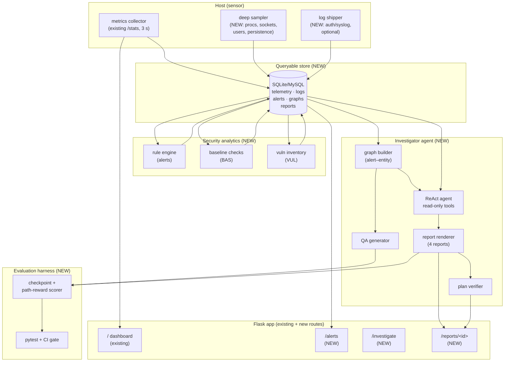
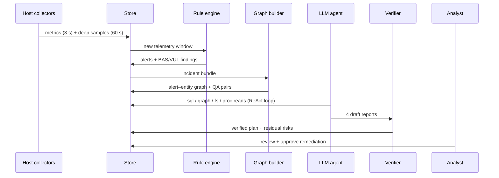

# AI-Agent Assisted System Monitoring and Post-Compromise Incident Response

## Project Report — Proposed System and Methodology

| Item | Details |
|---|---|
| **Project** | System Monitor — extended with AI-agent assisted threat investigation and incident response |
| **Base Paper 1** | Wang et al., *SecRespond: Benchmarking AI Agents for Real-World Post-Compromise Incident Response*, arXiv:2607.26791v1, 30 July 2026 (Tongyi Lab / Alibaba Cloud / HKUST) |
| **Base Paper 2** | Wu et al., *ExCyTIn-Bench: Evaluating LLM agents on Cyber Threat Investigation*, Proc. 43rd ICML, PMLR 306, 2026 (Penn State / Microsoft Security AI Research / Tsinghua / AG2AI) |
| **Repository** | `Sothiraj/system-monitor` (Flask + psutil + Bootstrap 5 + Chart.js) |
| **Date** | November 2026 |

---

## Table of Contents

- Chapter 1: Introduction
- Chapter 2: Literature Survey
- Chapter 3: Existing System
- Chapter 4: Proposed System
- Chapter 5: Methodology
- Chapter 6: Implementation Plan and Testing Strategy
- Chapter 7: Evaluation Plan
- Chapter 8: Expected Results and Discussion
- Chapter 9: Conclusion and Future Scope
- References
- Appendix A: Forensic Report Templates
- Appendix B: Seed Detection-Rule Catalog
- Appendix C: Glossary of Abbreviations
- Appendix D: Sample Scenario Definition

---

## Abstract

Host security operations today face a scale problem: analysts must sift through
large volumes of heterogeneous telemetry and logs, correlate multi-hop chains of
evidence, and then write verified remediation plans — all under time pressure.
Two recent benchmarks define this challenge precisely. **SecRespond** (Wang et
al., 2026) shows that LLM agents placed in a *post-compromise* setting — a
forensic disk snapshot plus alerts, vulnerability scans and baseline checks —
can surface alert-exposed problems but fail to proactively hunt silent
intrusions or to produce complete, verified remediation plans (no model
completes detection plus remediation on any of its 10 cyber ranges).
**ExCyTIn-Bench** (Wu et al., ICML 2026) shows that even the best agents score
only 0.606 reward when investigating threats by querying 57 security log tables
through automatically generated investigation graphs.

This report proposes a design that turns our existing lightweight **System
Monitor** (a Flask/psutil dashboard streaming live CPU, RAM, disk and network
telemetry) into an **AI-agent assisted monitoring and incident-response
platform**. The report is organised so that the **Proposed System** (Chapter 4:
what will be built — architecture, subsystems, data flows, database design,
requirements) and the **Methodology** (Chapter 5: how it will be built and run
— seven phased procedures, algorithms, scoring mathematics) are presented as two
fully separate chapters.

The methodology keeps the current collector as the *sensor layer*, adds a
*security analytics layer* (rule-based alerts, baseline checks, vulnerability
inventory), builds *investigation graphs* linking alerts to host entities
(processes, files, IPs, users), and drives an *LLM investigator agent* (ReAct
loop over read-only host/SQL/file tools) that produces SecRespond-style
forensic reports — intrusion analysis, baseline-risk assessment,
vulnerability-risk assessment — plus a verified remediation plan. Evaluation
adapts both base papers: hierarchical detection/planning checkpoints with a
five-dimension capability taxonomy (from SecRespond) and graph-anchored partial
rewards for investigation questions (from ExCyTIn-Bench).

**Keywords:** system monitoring, incident response, LLM agents, threat
investigation, post-compromise forensics, investigation graphs, psutil, Flask,
MITRE ATT&CK, ReAct.

---

# Chapter 1: Introduction

## 1.1 Overview

Every organisation, from a college laboratory to a cloud provider, depends on
hosts (servers, desktops, virtual machines) that must stay both *healthy* and
*secure*. Health is traditionally watched with performance monitors that chart
CPU load, memory pressure, disk consumption and network throughput. Security is
traditionally watched with a very different toolchain: antivirus products,
intrusion-detection systems, Security Information and Event Management (SIEM)
platforms, and, after something goes wrong, manual digital forensics.

These two toolchains rarely meet. A performance dashboard can show that CPU
usage jumped to 100% at 2 a.m., but it cannot say *which process* caused it,
*who started it*, *where it talks to*, or *whether it is malware*. Conversely,
a forensic investigation can answer all of those questions, but only after an
analyst spends hours or days pulling logs, disk images and memory dumps by
hand. The gap between "something looks odd" and "here is what happened and how
to fix it" is where modern attacks hide — cryptocurrency miners, ransomware
staging, webshells and data-exfiltration implants routinely live for weeks in
that gap.

This project attacks that gap. Its starting point is the **System Monitor**
repository: a small, working, cross-platform Flask application that polls the
host with `psutil` and renders live charts in the browser. Its destination, as
designed in this report, is an **AI-agent assisted monitoring and incident
response platform**: the same lightweight dashboard, plus a detection layer, an
investigation-graph layer, an LLM agent that investigates incidents, a
four-report forensic output contract, a remediation verifier, and an evaluation
harness that scores the whole pipeline the way the two base papers score
theirs.

## 1.2 Motivation

Three converging trends motivate this work:

1. **Attack volume and dwell time.** Industry telemetry consistently shows
   double-digit yearly growth in intrusions (cloud-environment intrusions alone
   rose ~75% from 2022 to 2023, per CrowdStrike, as cited in ExCyTIn-Bench),
   while median attacker dwell time is still measured in days. Human-only
   triage cannot scale; automation must move from alerting into *investigation
   and remediation*.
2. **LLM agents with tool use.** Since 2024, frontier models can iteratively
   reason, call tools (SQL, shell, file readers), observe results, and
   continue — the ReAct paradigm. Security vendors and researchers now give
   such agents host artifacts and CLIs. The question is no longer *whether* to
   use them but *how reliable* they are — exactly what SecRespond and
   ExCyTIn-Bench measure.
3. **The post-compromise reality.** Both base papers argue, with evidence, that
   pre-compromise testing (clean VMs, CTF-style tasks) overstates agent
   readiness. Real deployments meet agents *after* compromise: messy disks,
   partial logs, noisy alerts. Any serious methodology must therefore be
   post-compromise-first — detect, investigate, report, remediate, verify.

Our project embraces all three: a real sensor on a real host, a realistic
incident pipeline, and benchmark-grade measurement of the agent that works it.

## 1.3 Problem Statement

*Given a fleet of hosts streaming lightweight telemetry, how do we
automatically (a) detect suspicious activity, (b) investigate it across
multi-hop evidence spanning processes, files, network endpoints, users and
logs, (c) produce forensic-grade reports covering intrusions, baseline risks
and vulnerability risks together with a complete remediation plan, and (d)
measure the quality of that automation rigorously?*

Sub-problems include: keeping sensor overhead negligible; correlating
heterogeneous evidence into one incident graph; constraining the agent to safe,
read-only tools; forcing evidence citations to suppress hallucination; closing
the detection-vs-planning gap the base papers document; and building labelled
scenarios with ground truth so progress is measurable.

## 1.4 Objectives

1. Extend the existing collector to security-relevant telemetry (processes,
   sockets, users, persistence artifacts) while keeping overhead below 2% CPU
   on average.
2. Implement rule-based detection plus baseline checks plus a vulnerability
   inventory that together emit alerts, baseline findings and CVE findings.
3. Construct alert–entity investigation graphs from telemetry and logs, with
   automatic QA-pair generation for regression testing.
4. Implement a ReAct-style LLM investigator agent over a read-only tool
   sandbox that outputs the four SecRespond reports with evidence citations.
5. Implement a remediation-plan verifier that replays verification queries and
   reports residual risk.
6. Build an evaluation harness combining checkpoint scoring (Detection ×
   Planning across five CAP dimensions) with graph-anchored partial rewards,
   gated in CI.
7. Validate the full stack on 6–8 seeded attack scenarios mapped to MITRE
   ATT&CK techniques.

## 1.5 Scope of the Project

**In scope:** single-host and small-fleet (tens of hosts) monitoring on Windows
and Linux; host-centric evidence (no full packet capture); offline-capable
analytics and CVE snapshot; one swappable LLM agent backend; benchmark-style
offline evaluation; backward compatibility of the existing dashboard and
`/stats` API.

**Out of scope (for this phase):** network IDS / full-packet capture; automated
patch deployment to production (we verify in sandboxes only); real-time
streaming ML detection (rules first, learning later); mobile/IoT agents; GUI
forensics of desktop applications.

## 1.6 Organisation of This Report

- **Chapter 2** surveys the two base papers and related work, ending with the
  research gap.
- **Chapter 3** documents the existing system and its five limitations.
- **Chapter 4** presents the **Proposed System**: goals, architecture,
  subsystems, data-flow and UML views, database design, requirements, and
  advantages.
- **Chapter 5** presents the **Methodology**: the seven execution phases,
  detailed procedures, algorithms, and scoring mathematics.
- **Chapters 6–7** cover the implementation roadmap with testing strategy and
  the evaluation plan.
- **Chapter 8** discusses expected results; **Chapter 9** concludes with future
  scope. Appendices provide report templates, seed rules, and a glossary.

---

# Chapter 2: Literature Survey

## 2.1 Base Paper 1 — SecRespond: Benchmarking AI Agents for Real-World Post-Compromise Incident Response

### 2.1.1 Publication details and authors

Wang et al., *SecRespond: Benchmarking AI Agents for Real-World
Post-Compromise Incident Response*, arXiv:2607.26791v1, 30 July 2026. Authors
span Tongyi Lab (Alibaba Group), Alibaba Cloud Computing, and HKUST —
combining LLM-agent researchers with a production cloud-security team, which is
why the benchmark's artifacts (disk snapshots, product alerts, scan findings)
mirror real operations.

### 2.1.2 Problem addressed

All prior cybersecurity agent benchmarks, the authors argue, test agents
*before* compromise: the agent starts in a clean, idealised environment and
attacks or defends from scratch (CTF challenges, CVE exploitation, patching
exercises). Real security operations are the opposite: the host is *already*
compromised, evidence is partial and messy, and the job is to reconstruct what
happened and fix it completely. No benchmark measured that workflow, so vendor
and research claims about "AI SOC analysts" rested on unrepresentative tasks.

### 2.1.3 Task design

Each SecRespond task gives the agent:

- **Inputs:** (1) a forensic disk snapshot of a compromised host (frozen,
  reproducible, read-only); (2) the alerts, vulnerability-scan results and
  baseline-check results reported by a host security product.
- **Outputs:** one progress file plus **four reports** — intrusion analysis,
  baseline-risk assessment, vulnerability-risk assessment, and a structured
  remediation plan.

This input/output contract is deliberately product-realistic: it is exactly
what an on-call analyst receives from an EDR/XDR console plus a disk image.

### 2.1.4 Cyber-range construction

Ten cyber ranges are built from ten distinct, fully instantiated cloud hosts,
each compromised end-to-end over real network protocols through a complete
attack chain (initial access → privilege escalation → persistence → impact).
Together they span **4 entry-point types** (e.g. weak SSH baseline, application
RCE, supply-chain package, container escape), **21 MITRE ATT&CK techniques**,
and **5 operating systems**. Construction follows a 12-stage pipeline with
human experts auditing key steps: scenario blueprinting with ATT&CK annotation,
realisation on a victim host under constraints (real disclosed CVEs, realistic
services), attack execution, snapshot freezing, ground-truth labelling, and
rubric authoring.

### 2.1.5 Evaluation framework

The paper's central methodological contribution is a **hierarchical rubric**:

- **280 checkpoints** across the 10 ranges, each a concrete, checkable claim
  (e.g. "webshell file at /var/www/... identified", "persistence via cron
  entry removed in plan").
- **52 capability items** grouped into a five-dimension **CAP taxonomy**:
  Intrusion Entity (ENT — files, IPs, domains, accounts), Persistence
  Mechanism (PER — cron, services, kernel modules…), Baseline Risk (BAS —
  misconfigurations), Vulnerability Risk (VUL — CVEs), and Investigation &
  Response Quality (Q — timeline accuracy, completeness, verification).
- **Two scoring axes** per checkpoint: **Detection** (was it found?) and
  **Planning** (was it correctly handled in the remediation plan?).
- **LLM-as-a-Judge** grading with three strong proprietary judges, averaged
  per checkpoint, then aggregated to range level and CAP-dimension level so
  heterogeneous ranges become comparable.

### 2.1.6 Experiments and headline findings

Twenty-three frontier LLMs across eight model families run on the OpenCode
agent harness with identical prompts and toolsets:

1. The strongest model (Claude Opus 4.7) averages only **~72.4%** over
   detection and planning — and **no model achieves complete detection and
   remediation on any single range**.
2. **Detection beats planning for every model** (gap up to 34.7% for GPT-5.5):
   agents apply the obvious first fix but rarely finish the job.
3. Capability imbalance: average detection reaches ~75% on intrusion entities
   but only ~59% on persistence mechanisms; planning peaks at ~55% on baseline
   risk and far lower elsewhere.
4. Longer, broader attack chains degrade both axes sharply; silent artifacts
   (never alerted) are routinely missed.

### 2.1.7 Limitations of SecRespond (opportunities for us)

The benchmark is evaluation-only: it does not ship a deployable sensor,
detection rules, or a remediation-execution sandbox. Its ranges are cloud
images an academic team cannot easily reproduce at full fidelity. Our project
therefore *adapts* SecRespond (output contract, rubric philosophy, CAP
dimensions, judge protocol) to a lightweight, single-host stack with seeded
scenarios instead of full cloud ranges.

## 2.2 Base Paper 2 — ExCyTIn-Bench: Evaluating LLM Agents on Cyber Threat Investigation

### 2.2.1 Publication details and authors

Wu et al., *ExCyTIn-Bench: Evaluating LLM agents on Cyber Threat
Investigation*, Proceedings of the 43rd International Conference on Machine
Learning (ICML), PMLR 306, 2026. A collaboration between Pennsylvania State
University, Microsoft Security AI Research, Tsinghua University and AG2AI —
again pairing academic rigour with production telemetry (Microsoft Sentinel).

### 2.2.2 Problem addressed

Security analysts investigate threats by chaining evidence across dozens of
heterogeneous log tables — sign-ins, process launches, DNS queries, email
events, cloud-audit records. No benchmark measured whether LLM agents can do
this interactively: prior work tested single-shot SQL generation or static
question answering, never multi-hop investigation with tool feedback.

### 2.2.3 Testbed and data collection

The team built a fictional Azure tenant ("Alpine Ski House") with a SQL
environment replaying **8 multi-stage attack chains** (ransomware, backdoors,
fileless attacks, credential theft, lateral movement…). They collected **57
distinct log tables** from Sentinel and related services (8–139 columns each),
 sliced per incident for focused tasks, with a full-database mode for
long-horizon stress tests.

### 2.2.4 Graph-grounded QA methodology

The paper's core method has three steps:

1. **Detection logic** (rule-based and ML-based) converts raw logs into alerts;
   correlation logic groups alerts into incidents.
2. A **bipartite incident graph** is built per incident: alert nodes plus
   entity nodes (host, user, IP, file, process…), with timestamped edges.
3. An LLM **QA generator** creates question–answer pairs from node pairs: the
   start node becomes background context, the end node the answer, and the path
   between them the **explainable ground truth**, enabling automatic scoring
   and easy extension to new logs.

Total yield: **7,542 questions**, with a 589-question test split.

### 2.2.5 Agent environment and evaluation

Agents work inside a MySQL Docker image: **SQL queries are actions, result
sets are observations** (the InterCode pattern). Because each question is
anchored to a graph path, the evaluator awards **partial rewards** for
reaching intermediate nodes even when the final answer is missed — a far more
informative signal than binary accuracy.

### 2.2.6 Experiments and headline findings

Across proprietary, open-source, chat and reasoning models:

1. Best model (Claude-Opus-4.5) reaches **0.606 reward** — strong headroom for
   future work.
2. Agentic prompting helps consistently: **ReAct, ExPel, self-reflection and
   Best-of-N** all beat single-shot querying; combining strategy prompting
   with Best-of-N gives the largest gains.
3. **Full-database mode drops reward to ~0.248**: noise and long horizons hurt
   badly, which justifies per-incident slicing (our incident bundles).
4. Cost/latency analysis shows reasoning effort trades directly against turns
   and tokens — budgets matter and must be reported.

### 2.2.7 Limitations of ExCyTIn-Bench (opportunities for us)

The benchmark stops at investigation Q&A: it does not ask for forensic reports
or remediation plans, and its Azure/Sentinel stack is heavyweight for a
student lab. Our project therefore *adapts* ExCyTIn-Bench (graph builder, QA
generator, SQL-tool loop, partial rewards, ReAct default) to host telemetry
tables in SQLite/MySQL, and extends the terminal objective from "answer the
question" to "write the four reports and a verified plan" per SecRespond.

## 2.3 Related Work

| # | Work / Benchmark | Focus | Post-compromise? | Real filesystem/logs? | Rubric eval? | Relevance to us |
|---|---|---|---|---|---|---|
| 1 | SecBench (Jing et al., 2024) | Security knowledge MCQ | No | No | No | Background knowledge tests only |
| 2 | NYU CTF Bench (Shao et al., 2024) | CTF attack tasks | No | Partial | No | Tool-use precedent, wrong setting |
| 3 | CyBench (Zhang et al., 2025) | CTF attack tasks | No | Partial | No | Same as above |
| 4 | CVE-Bench (Zhu et al., 2025) | CVE exploitation | No | Partial | No | Real CVEs, but offensive-only |
| 5 | CyberGym (Wang et al., 2025) | Vuln discovery | No | Yes | No | Real FS, no IR workflow |
| 6 | AutoPatchBench (Meta, 2025) | Patching | No | Yes | No | Closest "fix it" analogue, pre-compromise |
| 7 | CyberSOCEval (Deason et al., 2025) | SOC triage | No | No | No | Alert triage only — the "easy part" |
| 8 | CyberModelArena (Wiz, 2026) | Full attack lifecycle | No | Yes | No | Harness-model co-eval precedent |
| 9 | **SecRespond (Base Paper 1)** | **Post-compromise IR** | **Yes** | **Yes** | **Yes** | **Report contract + rubric adopted** |
| 10 | **ExCyTIn-Bench (Base Paper 2)** | **Threat investigation** | **Yes** | **Logs** | **Partial rewards** | **Graph + QA + SQL loop adopted** |
| 11 | InterCode (Yang et al., 2023) | Interactive coding (SQL/Bash) | — | — | — | Act–observe loop pattern |
| 12 | ReAct (Yao et al., 2023) | Reasoning + acting | — | — | — | Default agent strategy |
| 13 | Reflexion (Shinn et al., 2023) | Verbal self-reflection | — | — | — | Agent improvement variant |
| 14 | ExPel (Zhao et al., 2024) | Experiential learning | — | — | — | Exemplar-based variant |
| 15 | Text-to-SQL family (C3-SQL, DIN-SQL, StructGPT) | NL→SQL generation | — | — | — | Query-reliability techniques |

The table (extended from SecRespond's own comparison) makes the gap visual:
only the two base papers combine post-compromise realism with fine-grained,
evidence-linked evaluation — and neither ships a deployable lightweight stack.

## 2.4 Research Gap and Project Positioning

**Gap.** No open, lightweight, host-first stack combines (i) continuous
telemetry sensing, (ii) graph-grounded multi-hop investigation, (iii)
forensic-grade reporting with verified remediation, and (iv) benchmark-style
self-measurement — in one reproducible methodology a small team can run.

**Positioning.** This project does not propose a new foundation model or a new
detection algorithm. Its contribution is *systems + methodology*: wiring a
proven sensor (psutil/Flask), proven investigation patterns (graphs, ReAct,
SQL tools), and proven evaluation patterns (checkpoints, CAP dimensions, path
rewards) into a single coherent platform, validated on seeded ATT&CK-mapped
scenarios. Each design choice traces to a base-paper finding (§5.9).

---

# Chapter 3: Existing System

## 3.1 System Overview

The existing system is the `Sothiraj/system-monitor` repository at its current
`HEAD`: a minimal, dependency-light Flask dashboard that polls the host
machine and charts live CPU, RAM, disk and network usage. It was built as a
developer-utility project (local and container-friendly), not as a security
product — which is precisely why it is a clean foundation to extend rather
than a prototype to discard.

Repository layout:

```
system-monitor/
├── app.py                  Flask app: / (dashboard), /stats (JSON), /healthz
├── utils/
│   └── monitor.py          psutil-based metric collection (get_stats)
├── templates/
│   └── index.html          Bootstrap 5 + Chart.js dashboard (polls /stats)
├── tests/
│   └── test_app.py         pytest suite for routes and payload schema
├── requirements.txt        runtime dependencies (Flask, psutil)
└── requirements-dev.txt    development dependencies (pytest)
```

## 3.2 Module-by-Module Description

### 3.2.1 Application entry point (`app.py`, 35 lines)

A stock Flask application with three routes: `/` renders the dashboard
template; `/stats` returns `jsonify(get_stats())`; `/healthz` returns
`{"status": "ok"}` for container orchestrators and uptime checks. The server
binds `0.0.0.0` (reachable from containers, proxies and port-forwarded
previews) with the port from the `PORT` environment variable (default 5000).
The Werkzeug debugger is strictly opt-in via `FLASK_DEBUG=1`, with a code
comment warning that it is a remote-code-execution surface — evidence of
security awareness already present in the codebase.

### 3.2.2 Metric collector (`utils/monitor.py`, 48 lines)

`get_stats()` gathers one snapshot per call:

- identity: `socket.gethostname()`, `platform.platform()`, uptime derived
  from `psutil.boot_time()`;
- CPU: `psutil.cpu_percent(interval=None)` (non-blocking, measured against the
  previous call's baseline, seeded once at import) plus logical CPU count;
- memory: `virtual_memory()` percent and used/total GiB;
- disk: `disk_usage()` percent and used/total GiB against `/` on POSIX or the
  `%SystemDrive%` root on Windows (cross-platform helper `_disk_root()`);
- network: cumulative bytes sent/received converted to MiB;
- timestamp: `time.time()`.

Notable engineering details: the import-time `cpu_percent()` seed guarantees
the first `/stats` response measures a real window; rounding to two decimals
keeps payloads small; the Windows/POSIX disk-root switch keeps the collector
portable.

### 3.2.3 Dashboard (`templates/index.html`)

A single-page Bootstrap 5 + Chart.js UI that polls `/stats` every 3 seconds
and updates CPU/RAM/disk/network charts plus host metadata. No build step, no
frontend framework, no authentication — appropriate for a local utility,
insufficient for a security console (see §3.4).

### 3.2.4 Tests (`tests/test_app.py`)

A pytest suite asserting route availability (`/`, `/stats`, `/healthz`),
payload schema (all keys in §3.3 present with sane types/ranges), and JSON
content type. This suite is the seed of the regression harness extended in
Chapter 6.

## 3.3 The `/stats` Payload Contract

```json
{
  "hostname": "lab-pc-03",
  "platform": "Linux-6.8.0-x86_64",
  "uptime": 45213.7,
  "cpu": 12.5,
  "cpu_count": 8,
  "ram": 41.2,
  "ram_used_gb": 6.59,
  "ram_total_gb": 16.0,
  "disk": 63.0,
  "disk_used_gb": 157.5,
  "disk_total_gb": 250.0,
  "net_sent": 112.44,
  "net_recv": 980.10,
  "timestamp": 1793123456.0
}
```

Semantics: `cpu`/`ram`/`disk` are percentages; `net_sent`/`net_recv` are
cumulative megabytes since boot (rates must be derived client-side by
differencing); `uptime` is seconds since boot. The methodology in Chapter 5
treats this payload as immutable (backward compatibility) and adds a parallel
`/stats/deep` payload for security telemetry.

## 3.4 Limitations of the Existing System

| # | Limitation | Concrete consequence | Closed by (proposed) |
|---|---|---|---|
| L1 | Performance-only signals | A 100% CPU spike cannot be attributed to a process, user, or socket | Deep sampler (M1), Ch. 4–5 |
| L2 | No detection layer | No thresholds, rules, baselines, or CVE awareness; anomalies pass silently | Analytics pipeline (M3–M5) |
| L3 | No persistence of history | Only the live instant is visible; no timelines, no before/after comparison | Telemetry store (M2) |
| L4 | No investigation support | No log store, entity correlation, or evidence chaining | Graph builder + agent (M6–M8) |
| L5 | No forensic output | No intrusion/baseline/vuln reports, no remediation plan | Reports + verifier (M9–M10) |
| L6 | No evaluation | Agent/automation quality cannot be measured | Eval harness (M11) |
| L7 | No multi-host view | One dashboard per host; lateral movement invisible | MySQL mode + fleet rollups |

## 3.5 Why Extend Rather Than Replace

Three reasons: (1) the collector already solves the hard portability problems
(Windows/POSIX, non-blocking CPU semantics, container networking); (2) the
dashboard and `/stats` API are stable contracts with passing tests — the
methodology adds alongside them, never breaking them; (3) both base papers
assume *some* sensor/product already exists and focus on what happens next
(investigation → reporting → remediation), so our sensor-plus-pipeline design
maps cleanly onto their framing.

---

# Chapter 4: Proposed System

> **Chapter scope.** This chapter describes **what** will be built: design
> goals, architecture, subsystems, data-flow and UML views, database design,
> functional and non-functional requirements, and advantages over the existing
> system. The **how** — phased procedures, algorithms, and scoring mathematics
> — is presented separately in Chapter 5 (Methodology).

## 4.1 Design Goals and Principles

1. **Backward compatibility first.** The existing dashboard, `/stats` schema,
   and tests must keep passing untouched. Every new capability is additive
   (new routes, new tables, new modules).
2. **Post-compromise-first.** Assume the host may already be compromised;
   optimise for reconstruction and verified remediation, not just prevention
   (SecRespond's core lesson).
3. **Evidence-grounded automation.** Every agent claim must cite a tool
   observation (row ID, file path + hash, graph node); uncited claims are
   rejected by a validation gate (ExCyTIn-Bench's explainable-ground-truth
   lesson).
4. **Read-only investigation.** The agent may read snapshots, query the store,
   and traverse graphs, but may never mutate a live host; remediation executes
   only in cloned sandboxes until human approval.
5. **Measurable by construction.** Checkpoints, QA pairs and rewards are
   produced as pipeline by-products, so evaluation is continuous rather than a
   one-off experiment.
6. **Lightweight and reproducible.** Single-host SQLite mode must run on a
   2-core student-lab PC; full MySQL multi-host mode via one Docker command.
7. **Swappable intelligence.** Detection rules, graph extractors, agent models
   and judges are configuration, not hardcoded logic — any of them can be
   ablated or upgraded independently.

## 4.2 High-Level Architecture

The proposed system keeps the current Flask app and dashboard 100% working and
adds three subsystems around them:

1. **Security analytics pipeline** — consumes telemetry and logs; emits
   alerts, baseline findings and vulnerability findings; persists everything
   to a queryable store.
2. **Investigation service** — builds incident graphs, hosts the LLM agent in
   a read-only tool sandbox, and serves investigation Q&A plus the four
   forensic reports through new routes (`/alerts`, `/investigate`,
   `/reports`).
3. **Evaluation harness** — offline and CI-integrated scorer replaying
   labelled scenarios and grading agent outputs with checkpoints and graph
   rewards.



## 4.3 Subsystem Descriptions

### 4.3.1 Sensor subsystem (SS1)

Owns all host data acquisition: the unchanged 3-second metrics collector, the
new 30–60 s deep sampler (top processes with pid/name/cpu/mem/cmdline-hash,
sockets with local/remote endpoints and owning pid, logged-in users, boot and
service deltas, persistence inventory), and an optional auth/syslog shipper.
It writes only to the store and exposes `/stats` and `/stats/deep`. Overhead
budget: <2% mean CPU, <100 MB RAM, <50 MB/day disk per host in SQLite mode.

### 4.3.2 Storage subsystem (SS2)

A relational store (SQLite for single-host/dev, MySQL for fleet/prod) with one
schema (§4.6) holding metrics, deep samples, logs, alerts, baseline and
vulnerability findings, graph nodes/edges, reports, verification results, and
evaluation artefacts. Retention policies (raw metrics 7 days, deep samples 30
days, incidents indefinitely) bound disk growth. The same SQL interface serves
the dashboard, the agent's `sql()` tool, and the evaluator — one query path to
secure and optimise.

### 4.3.3 Analytics subsystem (SS3)

Three deterministic engines run on every new telemetry window: the **rule
engine** (expert IF–THEN rules with confidence weights → `alerts`), the
**baseline checker** (expected-vs-observed configuration tests → BAS findings),
and the **vulnerability inventory** (software/CPE enumeration joined to an
offline CVE snapshot → VUL findings). Deterministic first, learned later: rules
are auditable, cheap, and directly mirror the "detection logic" stage of
ExCyTIn-Bench and the product-scan inputs of SecRespond.

### 4.3.4 Investigation subsystem (SS4)

Turns findings into understanding. The **graph builder** extracts entities and
timestamped relations into per-incident alert–entity graphs; the **QA
generator** mines node pairs into regression questions; the **ReAct agent**
investigates with read-only tools (`sql`, `graph_neighbors`, `host_fs`,
`host_proc`, `cve_lookup`) under a turn/token budget with mandatory evidence
citations; the **report renderer** emits the four Markdown+JSON reports. A
read-only snapshot discipline (copy-on-investigate) guarantees the agent can
never harm the live host.

### 4.3.5 Verification subsystem (SS5)

Closes the loop SecRespond found open: every IOC and persistence item must map
to ≥1 remediation step, every step must carry a verification query with an
expected post-state, and every query is replayed against before/after sandbox
states. Steps passing replay are marked VERIFIED; failures regenerate (bounded
retries) or escalate to an explicit residual-risk list. Nothing is silently
dropped.

### 4.3.6 Presentation subsystem (SS6)

Extends the Flask app with `/alerts` (sortable finding tables with severity
filters), `/investigate` (graph viewer + evidence timeline + agent trace),
`/reports/<id>` (the four rendered reports with verification badges), and an
alert banner on the existing dashboard. The original `/` and `/stats` behaviour
is frozen by contract tests.

### 4.3.7 Evaluation subsystem (SS7)

Offline + CI scorer combining SecRespond-style checkpoints (Detection ×
Planning, five CAP dimensions, multi-judge) with ExCyTIn-style QA path rewards,
plus operational metrics (turns, tokens, latency, cost). Outputs
`eval/scorecard.json` and trend charts; fails CI below thresholds (§7.3).

## 4.4 Data-Flow Design

### 4.4.1 Level-0 DFD (context diagram)

```
 ┌──────────┐  host facts   ┌─────────────────────────────┐  dashboards   ┌───────────┐
 │   Host   │──────────────▶│                             │──────────────▶│  Analyst  │
 │ (sensor) │              │   AI-ASSISTED SYSTEM MONITOR │◀──────────────│  (browser)│
 └──────────┘              │                             │  investigate /│ └───────────┘
 ┌──────────┐  CVE feed    │                             │  approve      ┌───────────┐
 │ CVE feed │──────────────▶│                             │──────────────▶│ LLM agent │
 │ snapshot │              └─────────────────────────────┘  tool reads   │ backend   │
 └──────────┘                       │      ▲                             └───────────┘
                        scenarios    │      │ scorecards
                                     ▼      │
                            ┌───────────────┐
                            │ Eval harness  │
                            │ (offline + CI)│
                            └───────────────┘
```

### 4.4.2 Level-1 DFD (major processes)

```
1.0 COLLECT ──metrics/deep/logs──▶ 2.0 STORE ──window──▶ 3.0 ANALYZE ──findings──▶ 2.0
                                                              │
                                                     incident bundle
                                                              ▼
4.0 GRAPH ◀──bundle── 2.0 ──graph──▶ 5.0 INVESTIGATE ──drafts──▶ 6.0 REPORT ──reports──▶ 2.0
   │                        (agent)                                  │
   └──QA pairs──▶ 8.0 EVALUATE ◀──reports+trace── 7.0 VERIFY ◀──────┘
```

### 4.4.3 Level-2 DFD (process 5.0 INVESTIGATE, expanded)

```
5.1 load bundle ──▶ 5.2 ReAct loop {reason → tool call → observe} ──▶ 5.3 citation gate
        ▲                        │ sql/graph/fs/proc/cve reads               │
        │                        ▼                                           ▼
   incident graph +      evidence ledger                              5.4 draft findings
   deep-sample window      (every claim → obs IDs)                     ──▶ 6.0 REPORT
```

## 4.5 UML Views

### 4.5.1 Use-case view

Actors: **Analyst**, **Scheduler** (cron/systemd timer), **LLM Agent**,
**CI Pipeline**. Core use cases: *View live dashboard* (existing), *Review
alerts*, *Open investigation* (graph + timeline), *Run agent investigation*,
*Read forensic reports*, *Approve remediation*, *Replay evaluation*. The
Scheduler extends *Collect telemetry*, *Run analytics*, *Build graphs* as
unattended flows; the CI Pipeline extends *Replay evaluation* with threshold
gates.

### 4.5.2 Sequence view (incident lifecycle)



### 4.5.3 Activity view (agent investigation)

`Load bundle → Summarise knowns/unknowns → WHILE (open questions AND budget
left): reason → select tool → execute → append evidence → re-check report
checklist → END → Draft findings → Citation gate (all claims cited?) → Emit
trace + drafts`. Reflection and Best-of-N wrap the loop as configurable
strategies (§5.5).

### 4.5.4 State view (incident lifecycle)

`NORMAL → SUSPECT (alert fired) → INVESTIGATING (agent running) → REPORTED
(4 reports) → VERIFIED (plan checks pass) → RESOLVED (analyst-approved)`,
with a side transition from any post-REPORTED state to `RESIDUAL-RISK`
when verification leaves uncovered items. Every transition is timestamped and
stored for timeline rendering and evaluation.

## 4.6 Database Design

One schema serves SQLite (dev) and MySQL (fleet); the agent's `sql()` tool and
the evaluator share it. Primary keys are `(host_id, ts)`-rooted for
partitioning; JSON columns hold variable detail.

| Table | Key columns | Purpose |
|---|---|---|
| `hosts` | `host_id` PK, hostname, platform, agent_ver, enrolled_at | Fleet registry |
| `metrics` | `host_id`, `ts`, cpu, cpu_count, ram_pct, ram_used_gb, ram_total_gb, disk_pct, disk_used_gb, disk_total_gb, net_sent_mb, net_recv_mb | 3 s stream (existing `/stats`) |
| `proc_samples` | `host_id`, `ts`, pid, ppid, name, exe, cmd_hash, cpu_pct, mem_mb, user | Deep sampler: processes |
| `socket_samples` | `host_id`, `ts`, pid, proto, local_ip, local_port, remote_ip, remote_port, state | Deep sampler: sockets |
| `user_sessions` | `host_id`, `ts`, user, source_ip, login_type | Deep sampler: sessions |
| `persist_items` | `host_id`, `ts`, kind (cron/service/suid/autorun…), path, hash, enabled | Persistence inventory |
| `auth_logs` | `host_id`, `ts`, user, source_ip, event (success/fail…), detail | Shipped auth events |
| `alerts` | `alert_id` PK, `host_id`, rule_id, severity, t_start, t_end, confidence, summary, evidence JSON | Rule-engine output |
| `baseline_findings` | `finding_id` PK, `host_id`, check_id, expected, observed, risk, evidence JSON | BAS output |
| `vuln_findings` | `finding_id` PK, `host_id`, cve_id, severity, package, reachability, evidence JSON | VUL output |
| `incidents` | `incident_id` PK, `host_id`, state, created_at, closed_at | Lifecycle tracker |
| `graph_nodes` | `incident_id`, `node_id`, ntype (alert/host/proc/file/ip/user/svc/cve), nkey, attrs JSON | Investigation graph |
| `graph_edges` | `incident_id`, src, dst, relation, ts, weight | Timestamped relations |
| `qa_pairs` | `qa_id` PK, `incident_id`, question, context_node, answer_node, path JSON | Regression set |
| `agent_traces` | `incident_id`, turn, thought, action, observation, tokens | Audit + eval input |
| `reports` | `incident_id`, kind (intrusion/baseline/vuln/plan), markdown, json, created_at | The four reports |
| `verify_results` | `incident_id`, step_id, covers_ioc, verify_sql, expected, pre, post, status | Plan verification |
| `checkpoints` | `scenario_id`, cp_id, cap_dim, cap_item, axis_det/plan criteria, weight | Eval rubric |
| `scores` | `run_id`, `incident_id`, metric, value, judge | Score history |

Indexes on `(host_id, ts)`, `(incident_id)`, `(cve_id)`, and full-text/JSON
indexes on evidence columns keep agent queries interactive (<200 ms p95 on
SQLite for single-host windows).

## 4.7 Functional Requirements

| ID | Requirement |
|---|---|
| FR-1 | Collect 3 s metrics identically to current `/stats` (frozen contract) |
| FR-2 | Collect deep samples (processes, sockets, sessions, persistence) every ≤60 s |
| FR-3 | Evaluate all detection rules on each window; write alerts with severity/confidence |
| FR-4 | Run baseline checks on schedule + on demand; record expected vs observed |
| FR-5 | Enumerate software/CPEs and join to CVE snapshot; record reachability |
| FR-6 | Build per-incident alert–entity graphs with timestamped edges |
| FR-7 | Generate QA pairs from graph node pairs with path ground truth |
| FR-8 | Run the ReAct agent with read-only tools under configurable budgets |
| FR-9 | Render the four forensic reports (MD + JSON) per incident |
| FR-10 | Verify every remediation step with replayed queries; list residual risks |
| FR-11 | Serve `/alerts`, `/investigate`, `/reports/<id>` alongside frozen `/` and `/stats` |
| FR-12 | Score runs with checkpoints + path rewards; persist scorecards; gate CI |

## 4.8 Non-Functional Requirements

| Category | Target |
|---|---|
| Performance | Sensor <2% mean CPU; `/stats` p95 <50 ms; agent simple-incident E2E <10 min |
| Scalability | 1 host (SQLite) → 50 hosts (MySQL) without schema change |
| Reliability | Collector crash must not kill Flask app (supervise separately); store WAL mode |
| Security | Read-only agent tools; no live-host mutation; secrets only via env; opt-in debug (existing) |
| Auditability | Every report claim → evidence IDs; full agent trace retained per incident |
| Portability | Windows 10+ and Linux (systemd + non-systemd); Python 3.10+ |
| Maintainability | Rules/checks/graph-extractors as data + plugins; ≥80% unit-test coverage on new code |
| Usability | Existing dashboard unchanged; new pages follow same Bootstrap theme; no JS build step |

## 4.9 Hardware and Software Requirements

| | Minimum (dev/single-host) | Recommended (fleet demo) |
|---|---|---|
| CPU/RAM/Disk | 2 vCPU, 4 GB RAM, 20 GB disk | 4 vCPU, 16 GB RAM, 100 GB SSD |
| OS | Windows 10 / Ubuntu 22.04+ | Ubuntu 24.04 + Docker |
| Python | 3.10+ (3.11 used) | 3.11 with venv |
| Store | SQLite (bundled) | MySQL 8 via Docker |
| LLM | Any tool-calling API (or local stub for tests) | Frontier tool-calling model + 2–3 judge models |
| Browser | Any modern browser | Same |

## 4.10 Advantages of the Proposed System

1. **From symptoms to stories:** telemetry becomes attributed, timestamped,
   entity-linked evidence instead of anonymous curves.
2. **From alerts to answers:** investigation graphs + the agent collapse
   multi-hour manual chaining into minutes with cited evidence.
3. **From suggestions to verified plans:** the verifier replays checks so
   "remediated" means *measured*, addressing the exact planning gap both base
   papers quantify.
4. **From demos to scorecards:** every change is graded by checkpoints and
   path rewards, making progress objective and CI-enforced.
5. **From rewrite to extension:** the working dashboard, API and tests survive
   untouched, de-risking adoption.

## 4.11 Interface Design (Routes, APIs and Screens)

### 4.11.1 HTTP route map

| Route | Method | Auth | Purpose | Phase |
|---|---|---|---|---|
| `/` | GET | — (lab) | Live dashboard (existing, frozen) | — |
| `/stats` | GET | — (lab) | Metrics JSON (existing, frozen schema) | P1 |
| `/healthz` | GET | — | Liveness probe (existing) | — |
| `/stats/deep` | GET | analyst | Latest deep sample (processes, sockets, sessions) | P1 |
| `/alerts` | GET | analyst | Paginated alerts + BAS/VUL findings w/ severity filters | P2 |
| `/alerts/<alert_id>` | GET | analyst | Single alert with evidence bundle | P2 |
| `/incidents` | GET | analyst | Incident list with lifecycle states | P2 |
| `/investigate/<incident_id>` | GET | analyst | Graph viewer + evidence timeline + agent trace | P3–P4 |
| `/investigate/<incident_id>/run` | POST | analyst | Launch agent investigation with profile + budgets | P4 |
| `/reports/<incident_id>` | GET | analyst | The four rendered reports + verification badges | P5–P6 |
| `/reports/<incident_id>.json` | GET | analyst | Machine-readable report bundle | P5 |
| `/eval/scorecard` | GET | analyst | Latest scorecard + trend charts | P7 |

Lab deployments keep the existing open-access convention; any network-exposed
deployment must front these routes with the site's standard authentication
(reverse-proxy SSO or Flask-Login), which is recorded as a hardening task in
Milestone M7 rather than a v1 feature.

### 4.11.2 The `/stats/deep` payload (new contract)

```json
{
  "hostname": "lab-pc-03",
  "timestamp": 1793123516.0,
  "processes": [
    {"pid": 4182, "ppid": 1, "name": "minerd", "user": "ops-temp",
     "cpu_pct": 392.5, "mem_mb": 410.2, "cmd_hash": "sha256:9f2c…"}
  ],
  "sockets": [
    {"pid": 4182, "proto": "tcp", "local": "10.0.2.15:51022",
     "remote": "45.148.x.x:3333", "state": "ESTABLISHED"}
  ],
  "sessions": [
    {"user": "ops-temp", "source_ip": "45.148.x.x", "login_type": "ssh"}
  ],
  "persistence_delta": [
    {"kind": "cron", "path": "/var/spool/cron/ops-temp",
     "change": "added", "detail": "*/5 * * * * /tmp/.x/run.sh"}
  ]
}
```

Design notes: command lines are hashed (not stored raw) to avoid retaining
embedded secrets; full cmdlines stay on the host snapshot for agent reads via
`host_proc()`; deltas keep the payload small on quiet hosts.

### 4.11.3 Screen wireframes (Bootstrap 5, same theme as existing dashboard)

- **`/alerts`**: severity filter chips (critical/high/medium/low) + rule-ID
  search; table rows expand to evidence JSON; "Open investigation" button per
  row; auto-refresh every 15 s.
- **`/investigate/<id>`**: left pane = incident graph (SVG, alert nodes in
  red, entities by shape, click-to-inspect with neighbour expansion); middle
  pane = evidence timeline (alerts, process/socket/session events in time
  order); right pane = agent trace (turn-by-turn thought/action/observation if
  a run exists) + "Run agent" form (profile select, budget overrides).
- **`/reports/<id>`**: tabbed view (Intrusion / Baseline / Vuln /
  Remediation) rendering stored Markdown; each remediation step shows its
  VERIFIED/FAILED/PENDING badge with replay transcript on expand;
  residual-risk callout box; "Download JSON bundle" and "Approve / Resolve"
  actions (approval transitions state per §4.5.4).

---

# Chapter 5: Methodology

> **Chapter scope.** This chapter describes **how** the proposed system is built
> and operated: seven sequential phases, each with entry criteria, inputs,
> step-by-step procedures, outputs, exit criteria, tooling, and base-paper
> grounding — followed by consolidated algorithms, scoring mathematics,
> configuration parameters, and a traceability matrix. Read Chapter 4 for the
> *what*; read this chapter for the *how*.

## 5.1 Methodological Overview

The methodology is a **layered, evidence-preserving pipeline**: each phase
consumes only the artefacts of earlier phases plus raw host truth, and emits
artefacts the next phase (and the evaluator) can independently check. The seven
phases are:

| Phase | Name | Question it answers |
|---|---|---|
| P1 | Security telemetry collection | *What is happening on the host, in attributable detail?* |
| P2 | Security analytics | *Which of it is suspicious, misconfigured, or vulnerable?* |
| P3 | Investigation-graph construction | *How is the evidence connected?* |
| P4 | LLM investigator agent | *What happened, and what is the proof?* |
| P5 | Forensic reporting | *What is the complete, structured account?* |
| P6 | Remediation verification | *Is the fix complete and does it check out?* |
| P7 | Evaluation and regression | *How good was all of the above, measurably?* |

Execution rhythm: P1 runs continuously (3 s / 60 s cadences); P2 triggers per
window; P3–P6 trigger per incident (alert-created or analyst-created); P7 runs
per scenario replay and per CI invocation. A single YAML profile
(`profiles/default.yaml`) pins cadences, thresholds, budgets, and model IDs so
any run is reproducible from one file.

## 5.2 Phase P1 — Security Telemetry Collection

**Entry criteria:** agent installed on host; store reachable; clock synced
(NTP); profile loaded.

**Inputs:** OS interfaces via `psutil` (processes, connections, users, boot
time), platform/socket metadata, optional auth/syslog stream.

**Procedure:**

- **Step P1.1 — Metrics stream (unchanged).** Keep calling `get_stats()` and
  serving `/stats` exactly as today. Additionally persist each sample to
  `metrics`. Rationale: freezing this contract protects the dashboard, the
  tests, and any external consumers.
- **Step P1.2 — Deep sample.** Every `deep_interval` (default 60 s):
  1. enumerate processes (`pid, ppid, name, exe, cmdline→sha256, cpu%, mem,
     username`), keeping top-N by CPU+mem plus any new pid since last sample;
  2. enumerate sockets (`pid, proto, local/remote ip:port, state`);
  3. enumerate logged-in users and session sources;
  4. diff boot-time, service/autorun lists, and persistence locations
     (cron/at/systemd on Linux; services/scheduled-tasks/run-keys via
     read-only inspection on Windows) against the previous sample, storing
     only deltas plus a full daily snapshot;
  5. write rows to `proc_samples`, `socket_samples`, `user_sessions`,
     `persist_items`; serve the latest as `/stats/deep`.
- **Step P1.3 — Log shipping (optional).** Forward auth/syslog lines matching
  an allowlist (logins, sudo, service installs) into `auth_logs` with host +
  timestamp keys. Denylisted patterns (passwords, tokens) are redacted
  pre-write by regex.
- **Step P1.4 — Retention enforcement.** Nightly job deletes `metrics` older
  than 7 days and non-delta deep rows older than 30 days; incidents and their
  evidence windows are pinned (never deleted while open).

**Outputs:** `metrics`, `proc_samples`, `socket_samples`, `user_sessions`,
`persist_items`, `auth_logs` rows; `/stats/deep` endpoint.

**Exit criteria:** 24 h soak with <2% mean collector CPU, zero `/stats`
contract-test failures, and successful restore-from-backup drill.

**Grounding:** supplies the "host artifacts" both papers assume; per-incident
evidence windows mirror ExCyTIn-Bench's per-incident slices (§3.1).

## 5.3 Phase P2 — Security Analytics

**Entry criteria:** P1 streaming; rule/check/CVE bundles loaded from versioned
files (`analytics/rules/*.yaml`, `checks/*.yaml`, `cve/snapshot.json`).

**Inputs:** the latest telemetry window W (default: trailing 15 min) plus the
pinned incident windows.

**Procedure:**

- **Step P2.1 — Rule-based alerting.** For each rule R in severity order:
  1. evaluate R's predicate over W (SQL + small Python helpers; App. B lists
     the 12 seed rules, e.g. *R-03 sustained-CPU + rare-outbound*,
     *R-05 new-listening-port*, *R-07 new-persistence-item*,
     *R-09 anonymous-IP sign-in*);
  2. on match, insert into `alerts` with `severity ∈ {low, medium, high,
     critical}`, `confidence ∈ [0,1]`, time bounds, and an `evidence` JSON
     bundle (row IDs, entities, window stats);
  3. deduplicate against open alerts (same rule + entities + 1 h) by extending
     `t_end` instead of duplicating.
- **Step P2.2 — Baseline checks.** For each check C (seed set of 10 in §B.2:
  SSH root/password policy, world-writable startup paths, audit-service
  state, sudoers hygiene, firewall state, auto-update state, share exposure,
  default credentials, kernel hardening flags, backup presence): compare
  observed state to the profile's expected state; on mismatch insert into
  `baseline_findings` with `risk ∈ {info, low, medium, high}` and evidence.
- **Step P2.3 — Vulnerability inventory.** Enumerate installed packages /
  images with versions → normalise to CPE-ish keys → join against the offline
  CVE snapshot → insert into `vuln_findings` with severity, and a
  `reachability` note (e.g. "service listens on 0.0.0.0:6379 without AUTH" vs
  "library present but no listening service"). Snapshot version is recorded
  with every finding for reproducibility.
- **Step P2.4 — Incident assembly.** Group new/updated alerts sharing
  host + overlapping window + ≥1 entity into an `incidents` row (state
  SUSPECT) with pointers to its evidence window; existing open incidents
  absorb matching alerts.

**Outputs:** `alerts`, `baseline_findings`, `vuln_findings`, `incidents`
(SUSPECT) rows; `/alerts` feed; dashboard banner counts.

**Exit criteria:** seed rules + checks fire correctly on 3 calibration
scenarios (benign, noisy-benign, malicious) with zero false negatives on the
malicious set.

**Grounding:** reproduces SecRespond's "alerts, vulnerability scans, baseline
checks reported by a host security product" (§3.1.1) and ExCyTIn-Bench's
expert detection-logic stage.

## 5.4 Phase P3 — Investigation-Graph Construction

**Entry criteria:** incident row in SUSPECT with a frozen evidence window.

**Inputs:** incident bundle = alerts + BAS/VUL findings + telemetry/log rows
in window.

**Procedure:**

- **Step P3.1 — Entity extraction.** Normalise every row into typed entities:
  Host, Process(pid+exe+cmd_hash), File(path+sha256), IP/Domain, User,
  Service, CVE, Alert. Deduplicate by `(type, key)`; store in `graph_nodes`
  with attribute JSON.
- **Step P3.2 — Edge extraction.** Emit timestamped, weighted relations:
  `Alert→INDICATES→Entity` (weight = confidence), `Process→SPAWNED_BY→Process`,
  `User→SPAWNS→Process`, `Process→CONNECTS→IP`, `Process→LISTENS_ON→Port`,
  `Process→WRITES/READS→File`, `File→PERSISTS_VIA→Service/Cron`,
  `Host→RUNS→Service`, `Service→EXPOSES→CVE`. Correlation keys: same host,
  ±Δt window (default 10 min), shared pid/ip/file/user. Store in
  `graph_edges`.
- **Step P3.3 — Incident graph finalisation.** Take the connected component(s)
  touching the incident's alerts as the incident graph; compute per-node
  degrees, earliest/latest timestamps, and the alert→artefact path inventory
  (cap path length K=4, cap pairs per incident to bound QA size).
- **Step P3.4 — QA generation.** For each sampled node pair (s,t) with path
  P: template-generate a question using s as background context and t as the
  answer, with P stored as explainable ground truth (`qa_pairs`). Templates
  are entity-typed ("Which external IP did process P connect to after T?",
  "Which persistence mechanism references file F?"), then optionally
  paraphrased once by the LLM for linguistic variety while freezing the
  (s,P,t) triple.

**Outputs:** `graph_nodes`, `graph_edges`, `qa_pairs`; `/investigate` graph +
timeline view.

**Exit criteria:** every alert in the incident touches the graph; sampled QA
pairs validated by script (answer node reachable; path edges exist).

**Grounding:** direct adaptation of ExCyTIn-Bench's bipartite incident graphs
and node-pair QA generator (§3), extended from log-only to host-telemetry
entities.

## 5.5 Phase P4 — LLM Investigator Agent

**Entry criteria:** incident graph + evidence window frozen; tool sandbox
healthy; model + budget configured.

**Inputs:** incident bundle (alerts, graph slice, deep-sample window, BAS/VUL
findings), report checklist, turn/token/time budgets.

**Procedure:**

- **Step P4.1 — Bundle summarisation (turn 0).** The agent writes a
  knowns/unknowns summary and an investigation plan (which entities, which
  time ranges, which hypotheses: miner? webshell? RCE? persistence?).
- **Step P4.2 — ReAct loop (Algorithm 2, §5.9).** Until the checklist is
  satisfied or budgets exhaust: reason → choose exactly one read-only tool →
  execute → append (thought, action, observation) to the trace with token
  counts. Toolset:
  - `sql(query)` — SELECT-only over store tables (allowlisted prefixes,
    row caps, timeout);
  - `graph_neighbors(node_id, hops≤2)` — evidence-path expansion;
  - `host_fs(path)` — read file metadata + head bytes from the *snapshot
    copy* (never live);
  - `host_proc(pid)` — process metadata from snapshot;
  - `cve_lookup(cve_id)` — offline snapshot detail.
- **Step P4.3 — Silent-artifact sweep (mandatory).** Before drafting, the
  agent must run a fixed sweep template: newest files in web roots/tmp,
  processes without on-disk exe, outbound IPs unseen in 7 days, persistence
  deltas, and users/sessions outside baseline. This step exists specifically
  because SecRespond found silent (never-alerted) artefacts the dominant miss
  class.
- **Step P4.4 — Strategy variants (config flags).** `reflection: on/off`
  (Reflexion-style self-critique every k turns), `exemplars: n` (ExPel-style
  retrieved past traces), `draft_samples: n` (Best-of-N report drafts, judge-
  picked). Defaults: reflection on, exemplars 2, drafts 1; ablations in §7.4
  vary these.
- **Step P4.5 — Citation gate.** Draft findings are accepted only if every
  factual claim cites ≥1 tool observation ID; failures return to the loop with
  the uncited claims listed (max 2 repair rounds), else the claim is dropped
  and logged.

**Outputs:** `agent_traces` rows (full turn log), draft findings with evidence
ledger; incident state → INVESTIGATING → ready-for-report.

**Exit criteria:** checklist complete (entry point hypothesised, IOCs listed,
persistence enumerated, timeline drafted, BAS/VUL cross-linked) or budget
exhausted with explicit open questions recorded.

**Grounding:** OpenCode-style harness per SecRespond §4.1; ReAct/Reflexion/
ExPel/Best-of-N evidence per ExCyTIn-Bench §4.

## 5.6 Phase P5 — Forensic Reporting

**Entry criteria:** draft findings + evidence ledger accepted by the citation
gate.

**Inputs:** trace, ledger, incident bundle, report JSON schemas (`schemas/`).

**Procedure:** render the four reports in order, each validated against its
schema before acceptance (field presence, ATT&CK-ID format, IOC typing,
citation coverage):

1. **`intrusion_report`** — executive summary, detailed timeline (ts, actor,
   action, evidence), entry point + ATT&CK technique IDs, IOC tables (files
   with hashes, IPs/domains, users, processes), persistence mechanisms,
   impact assessment, confidence notes. (Template: App. A.1.)
2. **`baseline_report`** — per BAS finding: check ID, expected vs observed,
   risk rating, evidence, and whether it enabled the intrusion. (App. A.2.)
3. **`vuln_report`** — per CVE: severity, affected asset/package,
   reachability/exploitability rationale on *this* host, evidence, and whether
   it was the entry point. (App. A.3.)
4. **`remediation_plan`** — ordered steps grouped Contain → Eradicate →
   Recover → Harden; each step: rationale, exact commands, expected
   post-state, rollback note, and a `verify` query. (App. A.4.)

Each report is stored as Markdown (human) plus JSON (machine) in `reports`;
incident state → REPORTED.

**Exit criteria:** all four schema-valid; every IOC appears in ≥1 report;
plan covers every persistence item at least nominally (P6 verifies).

**Grounding:** exact SecRespond output contract (§3.1.1), making our artefacts
directly comparable to benchmark expectations.

## 5.7 Phase P6 — Remediation Verification

**Entry criteria:** four reports accepted; verification sandbox (cloned VM or
container seeded from the incident snapshot) available.

**Inputs:** intrusion report (IOCs + persistence set P), remediation plan
(steps S).

**Procedure (Algorithm 3, §5.9):**

- **Step P6.1 — Coverage check.** For each p ∈ P ∪ IOCs: require ≥1 covering
  step; uncovered items go straight to the residual-risk list (never silently
  dropped).
- **Step P6.2 — Query replay.** For each covering step: run its `verify` query
  against BEFORE state (expect vulnerable/present) and AFTER state (simulated
  fix applied in sandbox; expect remediated/absent). Match → VERIFIED.
- **Step P6.3 — Bounded repair.** FAILED steps regenerate (agent revises
  command/expectation) up to 2 retries; persistent failures escalate to
  residual risk with rationale.
- **Step P6.4 — Sign-off pack.** Emit per-step statuses, replay transcripts,
  and the residual-risk list alongside the plan; incident state → VERIFIED
  (or RESIDUAL-RISK if the list is non-empty); analyst approval transitions to
  RESOLVED.

**Outputs:** `verify_results` rows; verification badges on `/reports/<id>`.

**Exit criteria:** coverage 100% (every IOC/persistence item covered or
explicitly residual); replay transcripts archived.

**Grounding:** operationalises SecRespond's Planning axis and its headline
finding that planning lags detection by up to 34.7%.

## 5.8 Phase P7 — Evaluation and Regression

**Entry criteria:** scenario pack with ground truth (§7.1) registered;
judge model(s) configured.

**Inputs:** agent traces, four reports, verification results, QA pairs,
checkpoint rubric.

**Procedure:**

- **Step P7.1 — Checkpoint scoring.** For each checkpoint c and axis
  a ∈ {det, plan}: collect judge scores (2–3 LLM judges + deterministic
  checks where exact matching suffices, e.g. IOC string presence), average to
  CHK(c,a); aggregate to incident level and CAP-dimension level (§5.10).
- **Step P7.2 — Path-reward scoring.** For each QA pair: replay the agent
  trace's reached-node set against the ground-truth path; award partial credit
  per intermediate node plus full credit for the answer node (§5.10).
- **Step P7.3 — Operational metrics.** Record turns, input/output tokens,
  wall-clock time, and estimated cost per incident; enforce budget caps.
- **Step P7.4 — Scorecard + gating.** Write `eval/scorecard.json` (per-scenario
  and aggregate tables + CAP radar data); fail CI if any §7.3 threshold is
  missed; append trend rows for drift detection.

**Outputs:** `scores` rows, scorecard JSON, trend charts, CI verdict.

**Exit criteria:** full scenario pack green (or explicitly waived with issue
links) before merge.

**Grounding:** fuses SecRespond's hierarchical rubric (§3.3, §4.2) with
ExCyTIn-Bench's partial-path rewards (§3–4).

## 5.9 Consolidated Algorithms

### Algorithm 1 — Investigation-graph construction (adapted from ExCyTIn-Bench)

```
Input : alerts A, entities E from window W, link window Δt, max path K
Output: incident graph G, QA pairs Q
1  V ← ∅; Edges ← ∅
2  for each alert a in A:
3      v_a ← AlertNode(a.id, a.rule, a.t_start, a.t_end); V ← V ∪ {v_a}
4      for each entity e linked to a (same host, ±Δt, shared pid/ip/file/user):
5          v_e ← EntityNode(e.type, e.key); V ← V ∪ {v_e}
6          Edges ← Edges ∪ {(v_a, INDICATES, v_e, a.confidence)}
7  for each entity pair (u,v) correlated in W:
8      Edges ← Edges ∪ {(u, relation(u,v), v, Δt)}
9  for each connected component C touching ≥1 alert:
10     for sampled node pairs (s,t) with path P, 1 ≤ |P| ≤ K:
11         Q ← Q ∪ {question(context=s, path=P, answer=t)}
12 return G=(V,Edges), Q
```

### Algorithm 2 — ReAct investigator loop with evidence citation

```
Input : bundle B, tools T (read-only), budgets (turns N, tokens K, time M)
Output: trace Tr, findings F
1  Tr ← [summarize(B)]; ledger ← ∅
2  for turn = 1 … N (and tokens < K, elapsed < M):
3      thought ← LLM.reason(Tr)
4      action  ← LLM.choose_tool(thought, T)
5      obs     ← execute(action); ledger ← ledger ∪ obs.ids
6      Tr.append((thought, action, obs))
7      if checklist_satisfied(Tr): break
8  run silent_artifact_sweep(T); append results to Tr        // mandatory
9  F ← LLM.draft_findings(Tr)
10 if ∃ claim in F with zero citations: repair (≤2 rounds) or drop claim
11 return Tr, F
```

### Algorithm 3 — Remediation-plan verification

```
Input : IOC/persistence set P, plan steps S, sandbox states BEFORE/AFTER
Output: verified plan S', residual risks RR
1  RR ← ∅
2  for each p in P:
3      covering ← {s ∈ S : covers(s,p)}
4      if covering = ∅: RR ← RR ∪ {p}; continue
5      for each s in covering:
6          pre  ← run(s.verify, BEFORE); post ← run(s.verify, AFTER)
7          s.status ← VERIFIED if (pre ≠ post = s.expected) else FAILED
8          if FAILED: retry ≤2 with regenerated s; still FAILED → RR ← RR ∪ {p}
9  return S', RR
```

## 5.10 Scoring Mathematics

**Checkpoint score** (per checkpoint c, axis a ∈ {det, plan}, judges J):

```
CHK(c,a) = (1/|J|) · Σ_j judge_score_j(c,a),   judge_score ∈ [0,1]
CHK_incident(a) = Σ_c w_c·CHK(c,a) / Σ_c w_c   (weights default 1)
CAP(d,a) = mean CHK(c,a) over checkpoints mapped to dimension d
Overall(a) = mean over dimensions; Overall = mean(Overall(det), Overall(plan))
```

**Path reward** (per QA pair with ground-truth path P = p0…pk, reached set R
from the agent trace, predicted answer â, true answer t):

```
path_recall = |{p0…pk} ∩ R| / (k+1)
reward = 0.4 · path_recall + 0.6 · 1[â = t]
```

**Combined incident score:**

```
Score = 0.5 · mean(CHK(det), CHK(plan)) + 0.5 · mean_QA(reward)
```

reported overall and per CAP dimension (ENT, PER, BAS, VUL, Q) so heterogeneous
incidents stay comparable — the exact property SecRespond's taxonomy was
designed for.

## 5.11 Configuration Parameters (profiles/default.yaml)

| Parameter | Default | Meaning |
|---|---|---|
| `metrics_interval_s` | 3 | Live metrics cadence (frozen) |
| `deep_interval_s` | 60 | Deep-sample cadence |
| `window_minutes` | 15 | Analytics window W |
| `link_delta_minutes` | 10 | Graph entity-link Δt |
| `max_path_len` | 4 | QA path cap K |
| `agent_turn_budget` | 40 | Max ReAct turns |
| `agent_token_budget` | 120000 | Max tokens/incident |
| `agent_time_budget_s` | 600 | Max wall-clock/incident |
| `reflection_every_k` | 6 | Self-critique cadence (0 = off) |
| `exemplars` | 2 | ExPel retrieved traces |
| `draft_samples` | 1 | Best-of-N report drafts |
| `verify_retries` | 2 | Plan-step repair attempts |
| `judges` | 2–3 model IDs | LLM-as-a-Judge panel |

## 5.12 Traceability Matrix (base-paper finding → methodology element)

| # | Base-paper finding | Methodology element |
|---|---|---|
| T1 | Agents miss silent artefacts (SecRespond) | Mandatory sweep P4.3; silent-recall metric §7.3 |
| T2 | Planning lags detection ≤34.7% (SecRespond) | P6 verifier; CHK(plan) CI gate |
| T3 | Obvious-first-fix incompleteness (SecRespond) | P6.1 coverage check; residual-risk list |
| T4 | Heterogeneous incidents need comparable dims (SecRespond) | CAP-dimension scorecard §5.10 |
| T5 | Multi-hop log chaining is the hard skill (ExCyTIn) | P3 graphs; path-reward metric |
| T6 | ReAct/reflection/BoN beat single-shot (ExCyTIn) | P4.2 default + P4.4 flags; ablations §7.4 |
| T7 | Full-DB noise collapses reward (ExCyTIn) | Frozen incident bundles/windows (P2.4, P3) |
| T8 | Cost/latency must be reported (ExCyTIn) | P7.3 operational metrics + budgets |

## 5.13 Worked Example: Scenario S1 (SSH-brute-force → miner), End to End

This section walks the full methodology on one concrete incident so that every
phase's inputs and outputs are tangible. The scenario: host `lab-pc-03`, weak
SSH credentials for user `ops-temp`, attacker IP `45.148.x.x`.

**P1 — Collection.** The 3 s metrics stream shows CPU climbing 12% → 97% over
ten minutes. The 60 s deep sampler records: new process `minerd` (pid 4182,
ppid 1, user `ops-temp`, ~390% CPU across cores); new ESTABLISHED socket
`10.0.2.15:51022 → 45.148.x.x:3333` owned by pid 4182; new SSH session
`ops-temp@45.148.x.x`; persistence delta: cron line
`*/5 * * * * /tmp/.x/run.sh` added. Auth logs show 214 failed SSH logins for
`ops-temp` in 6 minutes followed by one success.

**P2 — Analytics.** Rules fire: R-10 (brute-force-auth, high, conf. 0.95),
R-09 (anonymous-IP-signin, high, conf. 0.80 — the IP is in the anonymiser
range list), R-03 (miner-pattern, high, conf. 0.88), R-06 (rare-outbound,
medium, conf. 0.70). Baseline checks flag BAS-SSH-01 (password auth enabled,
high) and BAS-AUD-01 (audit service inactive, medium). Vuln inventory finds
`openssh-server 8.4` with CVE-2023-XXXX (medium, not the entry point).
Incident `INC-2026-001` is assembled in state SUSPECT with a 2-hour evidence
window pinned.

**P3 — Graph.** Nodes: 4 alerts + Host(lab-pc-03) + User(ops-temp) +
IP(45.148.x.x) + Process(minerd:4182) + File(/tmp/.x/minerd, /tmp/.x/run.sh)
+ Cron(persist:77) + CVE-2023-XXXX. Edges link alert→entities and
process→ip/file/user relations. QA pairs generated include: ("An SSH
brute-force alert (A-101) fired for user ops-temp; which external IP
authenticated successfully afterwards?" → 45.148.x.x, path A-101→User→Session→IP);
("Which persistence mechanism references /tmp/.x/run.sh?" → Cron:77).

**P4 — Agent.** Turn 0 plan: confirm entry (auth logs), attribute CPU (proc
samples), map C2 (sockets), sweep for siblings (silent artefacts). The ReAct
loop runs ~18 turns: SQL over `auth_logs` (214 fails + 1 success), over
`socket_samples` (pool IP + port 3333), `graph_neighbors(minerd, 2)` (reaches
run.sh + cron), `host_fs(/tmp/.x/run.sh)` (downloader stub — a silent artefact
no rule named), `cve_lookup` (rules out CVE entry). Sweep finds no second
implant. Citation gate passes: 23 claims, 23+ citations.

**P5 — Reports.** Intrusion report timelines 02:11 (brute force start) →
02:17 (success) → 02:19 (dropper write) → 02:21 (miner + C2 + cron);
techniques T1110/T1021.004/T1496/T1053; IOC tables; impact "CPU theft, no data
access observed". Baseline report ties BAS-SSH-01 as enabler. Vuln report
records the unrelated medium CVE. Remediation plan: C-1 block IP, C-2 disable
account, E-1 kill + delete implant + cron, E-2 rotate creds, R-1 restore from
clean snapshot point, H-1 disable password auth + enable auditing — each with
commands, expected post-state, rollback, and verify query.

**P6 — Verification.** Coverage: all 6 IOC/persistence items covered.
Replay: C-1 verified (0 sockets to pool IP post-rule), E-1 verified (no
minerd proc, cron line absent, file hash gone), H-1 verified (sshd_config
effective value `no`). One step (R-1 snapshot restore) is marked
MANUAL-APPROVAL in a student lab (no restore automation) and listed as
residual risk with rationale. Incident → VERIFIED (with 1 residual item).

**P7 — Evaluation.** Checkpoint scoring (2 judges + deterministic IOC checks):
detection 0.83 (missed: exact dropper-fetch URL, encrypted), planning 0.71
(lost points: R-1 unverified automatically). QA rewards: 0.80 mean over the
incident's pairs. Combined incident score ≈ 0.5·0.77 + 0.5·0.80 = 0.785.
Operational: 18 turns, ~41k tokens, 6.5 min — inside budgets. The scorecard
records per-CAP splits (PER planning lowest → follow-up work item).

---

# Chapter 6: Implementation Plan and Testing Strategy

## 6.1 Module Build Order

| # | Module (path) | Depends on | Phase |
|---|---|---|---|
| M1 | `utils/monitor.py` — add `get_deep_sample()` | — (extend) | P1 |
| M2 | `utils/store.py` — schema, retention, migrations | M1 | P1 |
| M3 | `analytics/rules.py` — rule engine + 12 seed rules | M2 | P2 |
| M4 | `analytics/baseline.py` — 10 seed checks | M2 | P2 |
| M5 | `analytics/vuln.py` — CPE enum + CVE join | M2 | P2 |
| M6 | `investigate/graph.py` — entity/edge extraction | M3–M5 | P3 |
| M7 | `investigate/qa_gen.py` — templates + paraphrase | M6 | P3 |
| M8 | `investigate/agent.py` — sandbox + ReAct loop + gates | M6, M7 | P4 |
| M9 | `investigate/reports.py` — schemas + renderer | M8 | P5 |
| M10 | `investigate/verifier.py` — coverage + replay | M9 | P6 |
| M11 | `eval/scorer.py` — checkpoints + rewards + scorecard | M7, M9, M10 | P7 |
| M12 | `app.py` + `templates/` — `/alerts`, `/investigate`, `/reports/<id>`, banner | M2, M6, M9, M10 | P2–P6 |
| M13 | `tests/` + `eval/scenarios/` — pack, regression, CI gate | M11 | P7 |

## 6.2 Milestone Roadmap (14 weeks)

| Milestone | Weeks | Deliverables | Demo |
|---|---|---|---|
| M1 Sensors + store | 1–2 | `get_deep_sample()`, `/stats/deep`, SQLite schema, retention job | Dashboard + deep JSON |
| M2 Analytics | 3–4 | Rule engine + 12 rules, 10 BAS checks, CVE join, `/alerts` + banner | Alerts on seeded miner |
| M3 Graphs + QA | 5–6 | Graph builder, `/investigate` viewer, QA generator, ≥200 QA pairs | Graph + timeline UI |
| M4 Agent | 7–9 | Tool sandbox, ReAct loop, trace log, citation gate | Agent trace on 2 scenarios |
| M5 Reports + verifier | 10–11 | 4-report renderer, `/reports/<id>`, plan verifier, residual list | Full 4-report set |
| M6 Eval + scenarios | 12–13 | 6–8 scenario pack, scorer, scorecard, CI gate | Scorecard + ablation table |
| M7 Hardening + docs | 14 | MySQL fleet mode, budget tuning, final report + demo video | End-to-end demo |

## 6.3 Testing Strategy

### 6.3.1 Levels

1. **Unit tests** (pytest, ≥80% coverage on new code): collector maths
   (deltas, rounding), rule predicates on synthetic windows, check comparators,
   graph extractors on fixtures, schema validators, reward functions on canned
   paths.
2. **Integration tests:** collector→store→analytics round trip on a scratch
   DB; graph→QA→scorer round trip; agent against a **stub tool backend**
   (scripted observations) to test loop/gate logic without LLM cost.
3. **System tests:** full incident lifecycle on disposable VMs/containers per
   §7.1 scenario; assert state machine reaches REPORTED/VERIFIED and all four
   reports validate.
4. **Regression tests:** frozen `/stats` contract tests (existing suite, must
   stay green); QA-pair answer stability; scorecard-threshold gates in CI.
5. **UAT:** analyst walkthrough (open alert → read graph → approve plan) timed
   and scored for usability issues.

### 6.3.2 Representative test cases

| ID | Level | Case | Expected |
|---|---|---|---|
| TC-01 | Unit | `cpu_percent` first-call seeding | Non-negative float, no exception |
| TC-02 | Unit | R-03 predicate on synthetic miner window | Fires, severity ≥ high |
| TC-03 | Unit | R-03 on benign compile workload | Does not fire |
| TC-04 | Unit | Schema validator rejects plan step without `verify` | ValidationError naming field |
| TC-05 | Unit | Path reward: full path + right answer | 1.0 |
| TC-06 | Unit | Path reward: half path + wrong answer | 0.2 |
| TC-07 | Integ | Collector→alerts on scratch DB | Alert row with evidence JSON |
| TC-08 | Integ | Agent stub: uncited claim | Repair triggered, claim dropped/logged |
| TC-09 | System | SSH-miner scenario E2E | 4 reports valid; miner IOC in plan; VERIFIED |
| TC-10 | System | Benign-noise scenario E2E | No incident above `low`; no false VERIFIED |
| TC-11 | Regr | Existing `/stats` suite | All green, byte-compatible keys |
| TC-12 | Regr | Scorecard thresholds on pack | CI green per §7.3 |

### 6.3.3 Defect handling and risk register

| Risk | Likelihood | Impact | Mitigation |
|---|---|---|---|
| LLM cost overruns eval | Medium | Medium | Stub-backend tests; budgets + caps; cache judge calls |
| Judge variance destabilises CI | Medium | Medium | 2–3 judges + deterministic checks; tolerance bands |
| Windows persistence APIs differ | High | Low | Read-only inspection only; per-OS extractor plugins |
| Scenario VMs drift/flaky | Medium | Medium | Frozen snapshots; infra-as-code rebuild scripts |
| Alert fatigue on noisy hosts | Medium | Low | Dedup + confidence tuning; severity review in M2 demo |

---

# Chapter 7: Evaluation Plan

## 7.1 Scenario Pack (ground truth)

Six to eight seeded attacks on disposable VMs/containers, each shipped with a
frozen snapshot, labelled IOCs, ATT&CK IDs, expected checkpoints, and QA pairs
— SecRespond's 10-range design at course-project scale:

| ID | Scenario | Chain sketch | ATT&CK (indicative) |
|---|---|---|---|
| S1 | SSH-brute-force → miner | Weak creds → implant → persistence → mining pool | T1110, T1021.004, T1496, T1053 |
| S2 | Redis RCE → persistence | Unauth Redis → RCE → cron implant → C2 | T1190, T1059, T1053, T1071 |
| S3 | Webshell upload | Vulnerable upload → webshell → privilege probe | T1505, T1105, T1068 |
| S4 | Malicious scheduled task/service | Dropper → scheduled persistence → staged exfil | T1053/T1543, T1048 |
| S5 | Container escape (opt) | Privileged container → host mount → host cron | T1611, T1053 |
| S6 | Dependency-confusion package (opt) | Malicious package → post-install script → beacon | T1195, T1059, T1071 |
| S7 | Benign noisy neighbour | Compile + backup + updates (no attack) | — (specificity control) |
| S8 | Vuln-only host | EOL service + CVEs, no active intrusion | — (VUL/BAS isolation) |

## 7.2 Metrics

| Metric | Source | Definition |
|---|---|---|
| `CHK_det` / `CHK_plan` overall | SecRespond | Weighted checkpoint means per axis |
| Per-CAP-dimension floors (ENT/PER/BAS/VUL/Q) | SecRespond | Worst-dimension guardrail |
| Mean QA path reward | ExCyTIn-Bench | §5.10 reward averaged |
| Silent-artifact recall | SecRespond finding | Fraction of non-alerted IOCs detected |
| Plan verification rate | §5.7 | VERIFIED steps / total steps |
| IOC→step coverage | §5.7 | IOCs covered or explicitly residual |
| Turns / tokens / seconds / cost | ExCyTIn-Bench §4 | Operational budget compliance |

## 7.3 Pass Criteria (v1 targets)

| Metric | Target |
|---|---|
| `CHK_det` overall | ≥ 0.70 |
| `CHK_plan` overall | ≥ 0.55 (must beat the papers' planning lag relatively) |
| No CAP dimension below | 0.45 on either axis |
| Mean QA path reward | ≥ 0.55 |
| Silent-artifact recall | ≥ 0.60 |
| Plan verification rate | ≥ 0.80 |
| Coverage (covered or residual) | 100% (no silent drops, by construction) |
| Budgets | Within profile caps on every scenario |

## 7.4 Ablation Plan

To attribute gains (as ExCyTIn-Bench §4 does), each scenario runs under: (A)
rules-only, no LLM; (B) LLM single-shot, no tools; (C) ReAct without graph
tools; (D) full ReAct (default); (E) D + reflection; (F) D + reflection +
Best-of-N drafts. Report ΔScore, Δcost, Δlatency per variant; the default
ships only if it Pareto-dominates on score-per-cost.

## 7.5 Evaluation Procedure

1. Freeze scenario snapshot → run P1–P3 → lock bundle + graph + QA.
2. Run agent (P4, fixed model + seed + profile) → render reports (P5) →
   verify plan (P6).
3. Score (P7): judges + deterministic checks + path rewards → scorecard.
4. Ablate (§7.4); record variant table.
5. CI gates merges on §7.3; trend charts flag drift across runs.

---

# Chapter 8: Expected Results and Discussion

## 8.1 Expected System Behaviour

On attack scenarios S1–S6 the pipeline is expected to: raise ≥1 high/critical
alert within two windows of implant activity; assemble one incident per attack
(no fragmentation); build graphs in which every labelled IOC is reachable from
an alert within 4 hops; produce four schema-valid reports whose remediation
plans verify at ≥80% in the sandbox; and record residual risks explicitly
wherever verification fails. On S7 (benign noise) no incident above `low` may
persist; on S8 findings must be confined to BAS/VUL reports with no invented
intrusion narrative — a hallucination tripwire.

## 8.2 Existing vs Proposed (comparison)

| Aspect | Existing system | Proposed system |
|---|---|---|
| Signals | 4 anonymous curves | Attributed entities + timelines |
| Detection | None | 12+ rules, 10 checks, CVE join |
| History | Live instant only | Retained, pinnable evidence windows |
| Investigation | Manual, unsupported | Graphs + cited agent traces |
| Output | Charts | 4 forensic reports + verified plan |
| Measurement | Route tests only | Checkpoints + path rewards + CI gates |
| Hosts | One dashboard each | Fleet-capable store + rollups |

## 8.3 Discussion: What the Base Papers Predict About Our Results

1. **Detection will lead planning.** Both papers' central quantitative result
   says our `CHK_plan` will trail `CHK_det`; the verifier (P6) exists to
   compress that gap, and the scorecard will show whether it does.
2. **Silent artefacts will dominate misses.** Expect the sweep (P4.3) and the
   silent-recall metric to be the highest-leverage additions; ablate the sweep
   to prove it.
3. **Graphs will beat raw querying.** ExCyTIn's full-DB collapse predicts that
   removing graph tools (ablation C) will cost more reward than removing
   reflection — a testable claim our harness can settle.
4. **Cost will scale with thoroughness.** Best-of-N and reflection should add
   points at measurable token cost; the score-per-cost frontier (§7.4) decides
   the shipped default.

## 8.4 Threats to Validity

Scenario realism (seeded ≠ wild), judge-model bias (mitigated by panels +
deterministic checks), single-team rubric authoring (mitigated by publishing
checkpoints for review), and hardware-specific timing (mitigated by fixed
seeds and relative ablations).

---

# Chapter 9: Conclusion and Future Scope

## 9.1 Summary

This report designed a complete path from the current System Monitor to an
AI-agent assisted incident-response platform. Chapter 4 specified the proposed
system — goals, architecture, seven subsystems, data-flow and UML views, a
19-table database design, functional/non-functional requirements, and
advantages. Chapter 5 specified the methodology separately — seven executable
phases with procedures and exit criteria, three consolidated algorithms,
scoring mathematics fusing both base papers, configuration parameters, and a
finding-to-element traceability matrix. Chapters 6–8 added the build roadmap,
testing strategy, evaluation plan with pass criteria, and a discussion of
expected results grounded in the base papers' empirical findings.

## 9.2 Contributions

1. A backward-compatible extension design: nothing working today breaks.
2. An evidence-preserving pipeline (sensor → analytics → graphs → agent →
   reports → verifier → scorer) where every stage's output is checkable.
3. A fused evaluation scheme (checkpoints × path rewards × operational
   budgets) that makes "good investigation" operationally measurable.
4. Reusable artefacts: report schemas, seed rules/checks, scenario-pack
   format, and QA regression sets.

## 9.3 Future Scope

1. **Learned detection:** mine confirmed incidents for new rules (human-gated);
   graduate to lightweight anomaly models once labelled volume suffices.
2. **Multi-host correlation:** cross-host entity resolution for lateral
   movement (S5 class) with fleet-wide graphs.
3. **Assisted patch orchestration:** sandbox-verified fixes promoted to
   staged rollout with automatic rollback.
4. **Broader judges and tasks:** terminal-task and GUI-forensic extensions;
   additional judge families to further cut bias.
5. **Red-team co-evolution:** a generator agent that synthesises novel attack
   variants to stress-test the investigator continuously.

---

# References

1. L. Wang et al., "SecRespond: Benchmarking AI Agents for Real-World
   Post-Compromise Incident Response," arXiv:2607.26791v1, Jul. 2026.
2. Y. Wu et al., "ExCyTIn-Bench: Evaluating LLM agents on Cyber Threat
   Investigation," in *Proc. 43rd Int. Conf. Machine Learning (ICML)*, PMLR
   306, 2026.
3. MITRE Corporation, "MITRE ATT&CK® Matrix for Enterprise."
   https://attack.mitre.org
4. S. Yao et al., "ReAct: Synergizing Reasoning and Acting in Language
   Models," in *Proc. ICLR*, 2023.
5. N. Shinn et al., "Reflexion: Language Agents with Verbal Reinforcement
   Learning," in *Proc. NeurIPS*, 2023.
6. A. Zhao et al., "Expel: LLM Agents Are Experienced Learners," 2024.
7. J. Yang et al., "InterCode: Standardizing and Benchmarking Interactive
   Coding with Execution Feedback," in *Proc. NeurIPS Datasets & Benchmarks*,
   2023.
8. OpenCode, "OpenCode Agent Harness," 2026. https://github.com/sst/opencode
9. G. Rodola, "psutil — Cross-platform process and system utilities."
   https://github.com/giampaolo/psutil
10. Pallets, "Flask Web Framework." https://flask.palletsprojects.com
11. J. Jing et al., "SecBench," 2024 (security-knowledge benchmark).
12. M. Shao et al., "NYU CTF Bench," 2024.
13. Y. Zhang et al., "CyBench," 2025.
14. Y. Zhu et al., "CVE-Bench," 2025.
15. Meta, "AutoPatchBench," 2025.
16. L. Wang et al., "CyberGym," 2025.
17. J. Deason et al., "CyberSOCEval," 2025.
18. Wiz, "CyberModelArena," 2026.

---

# Appendix A: Forensic Report Templates

## A.1 Intrusion Report Schema (intrusion_report)

```json
{
  "incident_id": "INC-2026-001",
  "summary": "2-4 sentence executive summary",
  "timeline": [
    {"ts": "2026-11-01T02:14:03Z", "actor": "attacker/unknown",
     "action": "SSH brute force began from 45.148.x.x",
     "evidence": ["alert:A-101", "auth_logs:88231"]}
  ],
  "entry_point": {"type": "weak-ssh-creds", "attck": ["T1110", "T1021.004"],
                  "evidence": ["alert:A-101"]},
  "techniques": ["T1110", "T1021.004", "T1496", "T1053"],
  "iocs": {
    "files": [{"path": "/tmp/.x/minerd", "sha256": "…", "evidence": ["graph:N-44"]}],
    "ips": [{"ip": "45.148.x.x", "role": "c2-pool", "evidence": ["graph:N-51"]}],
    "users": [{"user": "ops-temp", "role": "compromised", "evidence": ["auth_logs:88300"]}],
    "processes": [{"name": "minerd", "pid": 4182, "evidence": ["proc_samples:…"]}]
  },
  "persistence": [{"mechanism": "cron", "detail": "*/5 * * * * /tmp/.x/run.sh",
                   "evidence": ["persist_items:77"]}],
  "impact": "CPU theft; no data access observed; confidence medium",
  "open_questions": ["Was 45.148.x.x also used for exfil? Pool traffic encrypted."]
}
```

## A.2 Baseline Report Schema (baseline_report)

```json
{
  "incident_id": "INC-2026-001",
  "findings": [
    {"check_id": "BAS-SSH-01", "title": "SSH password authentication enabled",
     "expected": "PasswordAuthentication no", "observed": "yes (sshd_config:57)",
     "risk": "high", "enabled_intrusion": true,
     "evidence": ["baseline_findings:12"]}
  ],
  "summary": "2 weaknesses plausibly enabled/contributed; 1 unrelated."
}
```

## A.3 Vulnerability Report Schema (vuln_report)

```json
{
  "incident_id": "INC-2026-001",
  "findings": [
    {"cve_id": "CVE-2023-XXXX", "package": "redis-server 6.0.16",
     "severity": "critical", "reachability": "listens 0.0.0.0:6379, no AUTH",
     "entry_point": false, "evidence": ["vuln_findings:5"]}
  ],
  "summary": "1 critical reachable CVE (not the entry point); patch advised."
}
```

## A.4 Remediation Plan Schema (remediation_plan)

```json
{
  "incident_id": "INC-2026-001",
  "steps": [
    {"step_id": "C-1", "phase": "contain",
     "title": "Block attacker IP at host firewall",
     "commands": ["sudo iptables -A INPUT -s 45.148.x.x -j DROP"],
     "expected": "no ESTABLISHED sockets to 45.148.x.x",
     "verify": "SELECT COUNT(*) FROM socket_samples WHERE remote_ip='45.148.x.x'",
     "verify_expected": 0, "rollback": "sudo iptables -D INPUT -s 45.148.x.x -j DROP",
     "covers": ["ioc:ip:45.148.x.x"], "status": "VERIFIED"}
  ],
  "order": ["C-1", "C-2", "E-1", "E-2", "R-1", "H-1"],
  "residual_risks": []
}
```

---

# Appendix B: Seed Detection-Rule and Baseline-Check Catalogs

## B.1 Seed detection rules (analytics/rules/*.yaml)

| ID | Name | Predicate sketch | Default severity |
|---|---|---|---|
| R-01 | cpu-spike-sustained | cpu > 85% for ≥3 consecutive windows | medium |
| R-02 | mem-pressure-sustained | ram > 90% for ≥3 windows | medium |
| R-03 | miner-pattern | high cpu + new rare outbound IP + long-lived proc | high |
| R-04 | disk-fill-fast | disk growth > 5 GB in 1 window | medium |
| R-05 | new-listening-port | listening socket on port unseen in 7 days | medium |
| R-06 | rare-outbound | outbound IP unseen in 7 days + bytes > 50 MB | medium |
| R-07 | new-persistence-item | persist_items delta insert | high |
| R-08 | new-privileged-user-session | root/admin session from new source IP | high |
| R-09 | anonymous-ip-signin | sign-in from Tor/VPN-anonymised range | high |
| R-10 | brute-force-auth | ≥5 auth failures / user / 5 min | high |
| R-11 | exfil-pattern | large egress to single rare IP in short window | critical |
| R-12 | defence-tamper | audit/logging service stopped or config weakened | critical |

## B.2 Seed baseline checks (analytics/checks/*.yaml)

| ID | Name | Expected state |
|---|---|---|
| BAS-SSH-01 | SSH password auth | `PasswordAuthentication no` |
| BAS-SSH-02 | SSH root login | `PermitRootLogin no/prohibit-password` |
| BAS-PERM-01 | Startup-path writability | No world-writable dirs on boot path |
| BAS-AUD-01 | Audit service | Active and writing |
| BAS-SUDO-01 | Sudoers hygiene | No NOPASSWD ALL entries |
| BAS-FW-01 | Host firewall | Enabled with default-deny ingress |
| BAS-UPD-01 | Auto-updates | Enabled (or patch lag < 30 days) |
| BAS-SHR-01 | Share exposure | No unauthenticated network shares |
| BAS-CRED-01 | Default credentials | None on installed services |
| BAS-KRN-01 | Kernel hardening | Baseline sysctl profile applied |

---

# Appendix C: Glossary of Abbreviations

| Abbrev. | Meaning |
|---|---|
| ATT&CK | Adversarial Tactics, Techniques & Common Knowledge (MITRE) |
| BAS | Baseline Risk (CAP dimension) |
| CAP | Capability taxonomy (ENT/PER/BAS/VUL/Q) |
| C2 | Command and Control |
| CI | Continuous Integration |
| CPE | Common Platform Enumeration |
| CVE | Common Vulnerabilities and Exposures |
| DFD | Data-Flow Diagram |
| EDR/XDR | Endpoint/Extended Detection and Response |
| ENT | Intrusion Entity (CAP dimension) |
| IOC | Indicator of Compromise |
| IR | Incident Response |
| LLM | Large Language Model |
| PER | Persistence Mechanism (CAP dimension) |
| QA | Question–Answer (pair) |
| Q (CAP) | Investigation & Response Quality (CAP dimension) |
| ReAct | Reasoning + Acting (agent paradigm) |
| SIEM | Security Information and Event Management |
| SUID | Set-User-ID (POSIX permission bit) |
| UML | Unified Modeling Language |
| VUL | Vulnerability Risk (CAP dimension) |

---

# Appendix D: Sample Scenario Definition (S1, YAML sketch)

```yaml
scenario_id: S1
title: SSH-brute-force to miner
host: lab-pc-03 (Ubuntu 22.04 snapshot s1-base)
attack_steps:
  - {t: +0m,  action: "hydra ssh brute force u=ops-temp", expect: "R-10 fires"}
  - {t: +6m,  action: "login; curl dropper to /tmp/.x/run.sh", expect: "R-07 fires"}
  - {t: +8m,  action: "run.sh installs minerd; cron persist; pool connect",
      expect: "R-03, R-05/R-06 fire; incident assembled"}
ground_truth:
  iocs:
    files: ["/tmp/.x/minerd", "/tmp/.x/run.sh"]
    ips: ["45.148.x.x:3333"]
    users: ["ops-temp"]
    persistence: ["cron:/var/spool/cron/ops-temp"]
  attck: ["T1110", "T1021.004", "T1496", "T1053"]
checkpoints:
  - {cp: "S1-ENT-01", dim: ENT, det: "minerd file + hash identified",
     plan: "removal step with verify query present"}
  - {cp: "S1-PER-01", dim: PER, det: "cron persistence identified",
     plan: "cron removal + post-state check present"}
  - {cp: "S1-BAS-01", dim: BAS, det: "password-auth finding recorded",
     plan: "hardening step present"}
qa_seed_pairs: 12   # generated by P3.4; ≥8 must score reward ≥ 0.5
budgets: {turns: 40, tokens: 120000, seconds: 600}
```

---

*End of report — Proposed System and Methodology.*
